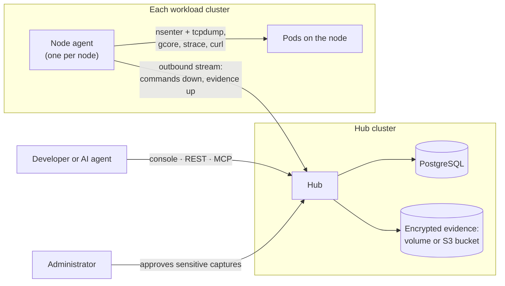

# Asservat

**Record the evidence where the problem happens.** Asservat captures packet
traces, core dumps, system call traces, profiles and logs from workloads in any
of your Kubernetes clusters, for problems you cannot reproduce in a lab.

[](https://github.com/phihos/asservat/actions/workflows/ci.yml)

> [!WARNING]
> **Early development: no release yet.** The end-to-end test records every
> evidence type below across two kind clusters. Nothing is qualified for
> production use.

## Overview

One **hub** serves a web console, a REST API and an MCP endpoint for AI agents.
Every cluster runs a **node agent** on each node. The agents connect out to the
hub, so workload clusters need no inbound access. You pick a workload, choose
what to record and download the result in its standard format for your own
tools. Packet captures, logs, pod state, system call traces, profiles,
flight recordings, goroutine or thread dumps and core dumps also open in the console, in
viewers that work like the usual tool for each: a packet capture looks like
it does in Wireshark, a profile is shown by pprof itself, a core dump like
a stopped program in a debugger.

| Evidence | What you get | Needs approval |
| --- | --- | --- |
| Pod state | The pod object and its events as JSON | No |
| Logs | Container logs: the last lines, the previous instance, or followed for a duration | No |
| Packet capture | A pcap file for Wireshark, filtered with tcpdump syntax | Only with payload; headers alone do not |
| System call trace | `strace` output with timing, following child processes | Only with buffer contents |
| CPU profile | Where the pod's processes spend CPU time, sampled from the node with eBPF. Needs no support in the application: Go, C, C++, Rust, Python, Java, Node.js, Ruby, PHP, Perl, .NET, Erlang | No |
| Memory growth | Which code makes the pod's memory grow while it records, from the stacks at its page faults. Same runtimes, needs no support in the application | No |
| Profile endpoint | The profile endpoints that the application serves, found for you: Go pprof, gperftools, Spring Boot Actuator, dotnet-monitor. A HotSpot JVM is asked itself, without an endpoint: thread dump, class histogram, heap dump, flight recording | Only memory dumps and endpoints Asservat does not know |
| Core dump | An ELF core of the container's main process, taken with `gcore` while it keeps running, with the program's files that a debugger needs next to it and a description of its threads and stacks, with goroutines, Python and .NET stacks | Yes |

A capture that can contain memory or payload contents waits until an
administrator approves it. Everything else starts at once.

## How it works



- **Who may capture what** is decided by each cluster's own RBAC: you may capture
  the workloads of a namespace if you may exec into its pods (`pods/exec`).
  That right already exposes a pod's memory, files and traffic. Administrators
  may capture everywhere.
- **Workloads keep Pod Security `restricted`.** The agent works from the node:
  it enters the pod's network namespace or attaches to its process. Nothing is
  added to your pods, with one exception: to ask a JVM for its own
  diagnostics, the agent writes an empty marker file into the container's
  `/tmp` and signals the JVM. No code is loaded into it.
- **Evidence is encrypted** by the hub before it is stored, each file with its
  own key. Only the requester, administrators and, once the requester shares it, the people who may capture in its namespace can download it, every
  download is recorded in the audit log, and evidence is deleted when its
  retention ends (7 days by default).

Read more in the [design](docs/design.md). For backups, upgrades, sizing and
troubleshooting, see [operating Asservat](docs/operations.md).

## Install

Install the hub together with the agents of its own cluster:

```sh
kubectl create namespace asservat
helm install asservat charts/asservat -n asservat -f values.yaml
```

```yaml
# values.yaml
hub:
  localCluster: prod-eu           # what this cluster is called in Asservat; "local" if you leave it out
  users:
    - name: alice                 # the subject your RBAC knows
      token: <32+ random characters>
      groups: [payments-devs]
    - name: root
      token: <32+ random characters>
      groups: [asservat-admins]   # administrators approve sensitive captures
```

The chart runs its own PostgreSQL and stores evidence on a volume unless you
configure an external database (`hub.database.existingSecret`) or an S3 bucket
(`hub.storage.s3`). Instead of static users you can use your OIDC issuer
(`hub.oidc`): the console then signs in there and the API accepts its ID
tokens. Register `https://<hub-host>/auth/callback` as redirect URI. Name the
hub's own cluster (`hub.localCluster`) before you record: captures and watches
keep the name they were made under, so after a later change the finished
captures still show the old name and watches for it no longer find a cluster
and have to be made again. The agent pods run as root with the node's PID namespace and extra
capabilities, so their namespace must allow Pod Security `privileged`.

> [!NOTE]
> There are no releases yet. The chart installs the image of the latest
> commit on `main` (`ghcr.io/phihos/asservat:main`, and `:main-agent` for the
> agents). Set `image.tag` to a full commit hash to pin a version.

### Join another cluster

Clusters are part of the hub's configuration, not something to click
together.

1. Make a join token (`openssl rand -hex 32`) and list the cluster in the
   hub's values, then upgrade the hub's release:

```yaml
hub:
  clusters:
    - name: <cluster-name>
      token: <join-token>
```

2. Install only the agents in that cluster, with the same token:

```sh
helm install asservat charts/asservat -n asservat --create-namespace \
  --set hub.enabled=false \
  --set agent.hubURL=https://<hub-host> \
  --set agent.token=<join-token>
```

## Use

Open the console (`kubectl -n asservat port-forward svc/asservat-hub 8080:80`),
sign in with your token and choose **New capture**: four steps take you from
the workload to what to record and when. **Captures** lists what was
recorded, with the progress and the files of each. One request can hold several
recordings: they start together on the same pods, share the time frame and,
if one of them needs approval, a single approval.

A capture is yours and the administrators'. **Share with the namespace** in
its details lets everyone who may capture in that namespace open and
download it; they cannot change or delete it. Administrators see who
requested, approved, opened and downloaded what under **Audit log**.

The same with the API:

```sh
curl -H "Authorization: Bearer $TOKEN" -X POST https://<hub-host>/api/captures -d '{
  "cluster": "prod-eu", "namespace": "payments", "workload": "Deployment/api",
  "durationSeconds": 30,
  "recordings": [
    {"kind": "pcap", "params": {"filter": "tcp port 5432"}},
    {"kind": "logs"},
    {"kind": "coredump"}
  ]
}'
curl -H "Authorization: Bearer $TOKEN" https://<hub-host>/api/captures/<id>
curl -H "Authorization: Bearer $TOKEN" -O https://<hub-host>/api/captures/<id>/artifacts/<pod>/capture.pcap
```

You do not need to know process names or filter syntax. The console lists
the programs that run in the workload's pods for a core dump or trace, and
**Sample live traffic** shows whom the pods talk to right now; ticking
connections there builds the packet filter.

To catch a problem you cannot be present for, choose in the console's last
step when to record, or create a watch. A watch records the pod that meets
its condition: by default a container that crashes, with `"when": {"kind":
"restart"}` a container that is started again, with `"not-ready"` a pod that
stops being ready, with `"log"` and a `pattern` a container that writes a
matching log line, with `"memory"`, `"cpu"` or `"throttled"` and a threshold
`above` a container that uses that much; likewise `"memory-growth"`,
`"pressure"`, `"threads"`, `"open-files"`, `"tcp-retransmits"` and
`"tcp-failures"`, with `"event"` a pod that Kubernetes warns about, with
`"time"` and `at` all pods at that time. Any watch also records when asked
(`POST /api/watches/<id>/record`). Packets and the sampled CPU profile are kept running
while the watch waits, so their files begin `beforeSeconds` before that
moment and show what led to it:

```sh
curl -H "Authorization: Bearer $TOKEN" -X POST https://<hub-host>/api/watches -d '{
  "cluster": "prod-eu", "namespace": "payments", "workload": "Deployment/api",
  "kind": "pcap", "durationSeconds": 60, "count": 3
}'
```

With `"alert"` and a `name`, a watch waits for a Prometheus alert. Give the
hub a secret (`hub.alertToken`) and Alertmanager a receiver that presents it:

```yaml
receivers:
  - name: asservat
    webhook_configs:
      - url: https://<hub-host>/api/alerts
        send_resolved: false
        http_config:
          authorization:
            credentials: <hub.alertToken>
```

Route the alerts that watches are to wait for to this receiver, with
`continue: true` if they also go elsewhere. The alert's `pod` label names
the pod that is recorded.

With the Prometheus operator, `hub.alertmanagerConfig.enabled=true` installs
this receiver and a route for every alert as an `AlertmanagerConfig`. An
Alertmanager passes it only the alerts of the hub's own namespace unless its
`alertmanagerConfigMatcherStrategy` is `None`.

A crash watch for `coredump` records the core of the crashed process itself. It
needs the agents' core handler (`agent.coreHandler.enabled=true`), which
replaces the node's `kernel.core_pattern` while the agents run, and an
administrator's approval of the watch. Cores of other processes on the node
go on to the handler the node had before, such as apport or
systemd-coredump.

Every core comes with its program's executable and libraries, so that it
opens in a debugger wherever you download it to, and with a description for
the console's viewer: threads, stacks and variables, the goroutines of a Go
program even without debug information, the Python and .NET stacks, and
stacks through musl. For stripped programs the debug information is fetched
from debuginfod servers, the distributions' debug packages and, for .NET,
Microsoft's symbol server. This is on by default and sends these servers the
build IDs of the programs and libraries and the names of their packages,
nothing of a process's memory. Set `debuginfodURLs: []` to turn all of it
off.

AI agents connect to `https://<hub-host>/mcp` with the same bearer token and
get tools to list workloads, look at their processes and traffic, request
captures, watch for crashes and other conditions, and read evidence: text files as they are, a
profile as its list of the heaviest functions, a heap dump as its classes
by size, a packet capture as its statistics or the packets that match a
display filter, a core dump as the stacks of its program and threads. The
core itself downloads over the REST API with the same token.

> [!WARNING]
> A downloaded file is outside Asservat's control: it is not deleted when
> the retention ends. A core dump pauses the process while it is written,
> and `strace` slows the traced process.

## Develop

```sh
go test ./...                    # unit tests
ASSERVAT_TEST_DSN=postgres://... go test ./...   # plus the hub flow with PostgreSQL
ASSERVAT_TEST_S3=host:port,key,secret go test ./internal/hub   # plus the S3 evidence store
test/e2e/run.sh                  # two kind clusters, every evidence type
```

## History

Before November 2026 this repository held a much larger design and
implementation. It ends at commit `2ccfa535`; use it for reference, for example
its research on core dump helpers, eBPF recorders and capture rings.

## Contributing and license

Read the [contributing guide](CONTRIBUTING.md) before opening a pull request.
Asservat is licensed under the [Apache License 2.0](LICENSE).
