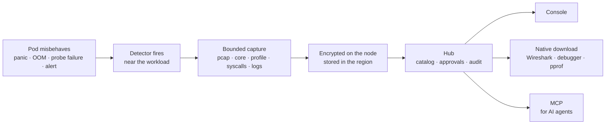
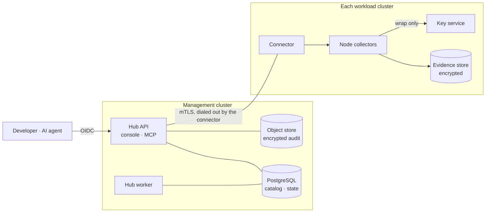

# Asservat

**Catch the evidence before the pod restarts.**

When a Kubernetes workload misbehaves, Asservat captures what you need to debug
it: packet captures, core dumps, CPU and heap profiles, syscall traces, logs and
files. It works within limits you set, close to the workload and encrypted from the
first byte. Developers download native files for their own tools; AI agents query
the same evidence through MCP under the same permissions.

[](https://github.com/phihos/asservat/actions/workflows/ci.yml)

> [!WARNING]
> **Early development, not ready for use.** The design is complete and many
> components pass tests against real Kubernetes, PostgreSQL, OpenBao and S3. The
> end-to-end investigation workflow is unfinished, and no collection is enabled
> for users. See [implementation status](docs/implementation-status.md).


<sub>Design prototype with synthetic data.</sub>

## Why Asservat

By the time someone is paged, the container has restarted, the packets are gone
and the memory spike has passed. "Can you reproduce it?" is the usual next step.
Asservat records what happened while it happens.

- **Capture on trigger, not on request.** Point a policy at a Deployment or
  StatefulSet. Log patterns, resource thresholds, probe failures, crashes and
  external alerts start bounded evidence recipes on the affected pod.
- **The evidence you actually need.** Logs, files and `/proc`, packet captures
  with pcap filters and Kubernetes-aware peers, HTTP headers, pprof-style runtime
  profiles, core dumps, syscall traces and custom commands. Reusable capture
  profiles combine them.
- **Your tools, native files.** PCAPNG for Wireshark, cores with their companion
  files for your debugger, profiles for pprof. No proprietary viewer in the way.
- **Made for AI agents.** A typed MCP interface lets your coding agent find cases,
  summarize crashes and profiles, query packets and request new captures, with
  your permissions. Asservat embeds no LLM.
- **Watch live, keep the last 30 seconds.** Packet and syscall recorders run
  continuously within limits. Watch approved projections and save a window before
  it rotates away.
- **Permissions you already have.** Reuse namespace metadata, RBAC and even
  pod-exec rights. Manage bindings as CRDs, through `kubectl` or GitOps.
- **Safe in production.** Per-workload quotas and capture-storm protection,
  approval for intrusive actions, expiring policy grants, encryption on the node,
  administrator-enforced retention, and workloads stay at Pod Security `restricted`.
- **One hub, many clusters, no call-home.** Central management for your
  organization, installed with Helm. No telemetry, no SaaS, no licence keys.

## How it works



A policy can be this small. The `workload-failure` preset supplies the detectors,
recipe, limits and retention:

```yaml
apiVersion: asservat.io/v1alpha1
kind: DebugPolicy
metadata:
  name: api-failures
  namespace: payments
spec:
  presetRef:
    name: workload-failure
    version: v1
  target:
    workloadRef:
      kind: Deployment
      name: api
  logPattern:
    match: literal
    value: 'panic:'
```

Need more control? [Combine detectors and capture profiles](examples/policy-composed.yaml)
or browse [all examples](examples/README.md).

## Architecture



Raw evidence, keys and analysis stay in the workload's region; the hub keeps the
catalog, approvals and encrypted audit. Connectors dial out, so the hub never holds
cluster kubeconfigs. Details: [architecture](docs/architecture.md) and
[security model](docs/security.md).

## A look at the console

<table>
  <tr>
    <td width="50%"><br><b>Review before collecting.</b> Impact, possible user data, retention and who can read the result, with one approval for collection and access.</td>
    <td width="50%"><br><b>Evidence with honest coverage.</b> Kubernetes-aware peers, allowlisted HTTP fields and explicit gaps.</td>
  </tr>
  <tr>
    <td width="50%"><br><b>Watch live.</b> Approved projections of an ongoing recording; save the last 30 seconds in one click.</td>
    <td width="50%"><br><b>Download native files.</b> PCAPNG, cores and profiles for your local tools.</td>
  </tr>
</table>

<sub>Design prototype with synthetic data. The [full prototype](docs/ux/README.md) has 63 screens.</sub>

## Status

Asservat is built in vertical slices with every claim backed by recorded test
runs. Implemented and tested against real services: OIDC sign-in (Keycloak
reference), Kubernetes permission observation, encrypted pod-context capture and
publication, audited native downloads, multi-cluster connector enrollment and
the Helm bootstrap. Packet, core, profile and syscall collectors are designed
but not yet built.

The next milestone is a complete installed investigation across two clusters.
Track it in [implementation status](docs/implementation-status.md) and
[implementation progress](docs/implementation-progress.md).

## Learn more

- [Product definition](docs/product.md): users, workflows, requirements and boundaries
- [Behavior specifications](specs/README.md): normative behavior and acceptance scenarios
- [MCP workflows](docs/interfaces/mcp-workflows.md): what an agent can do, tool by tool
- [Security model](docs/security.md): threats, grants, sharing, isolation and privacy
- [Helm installation](docs/installation/helm.md): the official installation method and its current scope
- [Decision records](docs/decisions/README.md): every accepted design decision
- [Project guide](docs/project-guide.md): full reading map, component notes and validation commands

## Development

Go, React/TypeScript and PostgreSQL. `make spec-check architecture-check` validates
the specification; `make go-check` runs the Go gate; native suites such as
`make context-integration` create and remove their own kind clusters and services.
CI runs on every push; see [validation](docs/validation.md) for all gates.

## License

[Apache License 2.0](LICENSE). Contributions are welcome under the same terms; see
[contributing](CONTRIBUTING.md).
