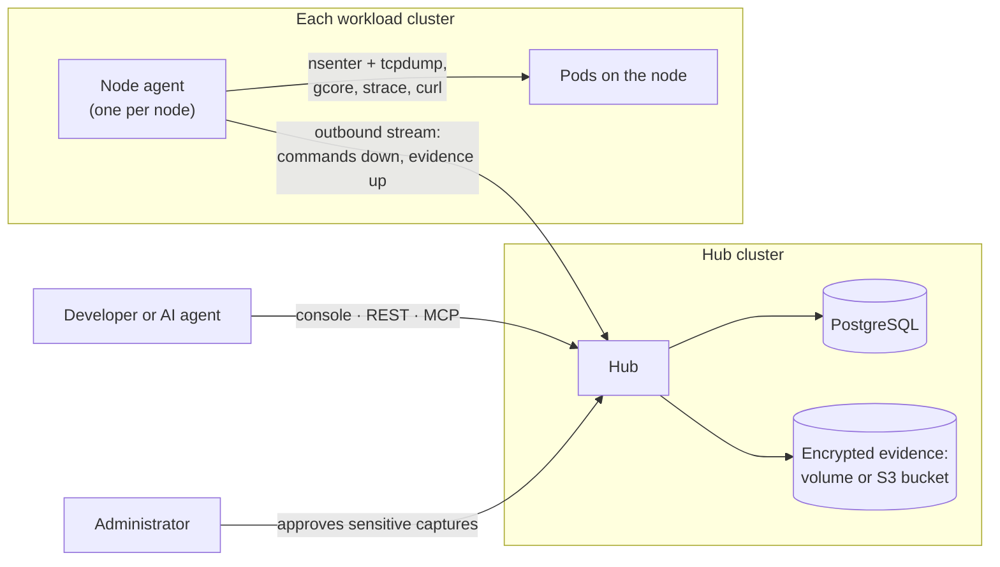

# Asservat

**Record the evidence where the problem happens.** Asservat captures packet
traces, core dumps, system call traces, profiles and logs from workloads in any
of your Kubernetes clusters, for problems you cannot reproduce in a lab.

[](https://github.com/phihos/asservat/actions/workflows/ci.yml)

> [!WARNING]
> **Early development: no release yet.** The end-to-end test records every
> evidence type below across two kind clusters. Nothing is qualified for
> production use.

## Overview

One **hub** serves a web console, a REST API and an MCP endpoint for AI agents.
Every cluster runs a **node agent** on each node. The agents connect out to the
hub, so workload clusters need no inbound access. You pick a workload, choose
what to record and download the result in its standard format for your own
tools.

| Evidence | What you get | Needs approval |
| --- | --- | --- |
| Pod state | The pod object and its events as JSON | No |
| Logs | Container logs: the last lines, the previous instance, or followed for a duration | No |
| Packet capture | A pcap file for Wireshark, filtered with tcpdump syntax | Only with payload; headers alone do not |
| System call trace | `strace` output with timing, following child processes | Only with buffer contents |
| Profile | The profile endpoints that the application serves, found for you: Go pprof, gperftools, Spring Boot Actuator, dotnet-monitor | Only memory dumps and endpoints Asservat does not know |
| Core dump | An ELF core of the container's main process, taken with `gcore` while it keeps running | Yes |

A capture that can contain memory or payload contents waits until an
administrator approves it. Everything else starts at once.

## How it works



- **Who may capture what** is decided by each cluster's own RBAC: you may capture
  the workloads of a namespace if you may exec into its pods (`pods/exec`).
  That right already exposes a pod's memory, files and traffic. Administrators
  may capture everywhere.
- **Workloads keep Pod Security `restricted`.** The agent works from the node:
  it enters the pod's network namespace or attaches to its process. Nothing is
  added to your pods.
- **Evidence is encrypted** by the hub before it is stored, each file with its
  own key. Only the requester and administrators can download it, every
  download is recorded in the audit log, and evidence is deleted when its
  retention ends (7 days by default).

Read more in the [design](docs/design.md).

## Install

Install the hub together with the agents of its own cluster:

```sh
kubectl create namespace asservat
helm install asservat charts/asservat -n asservat -f values.yaml
```

```yaml
# values.yaml
hub:
  users:
    - name: alice                 # the subject your RBAC knows
      token: <32+ random characters>
      groups: [payments-devs]
    - name: root
      token: <32+ random characters>
      groups: [asservat-admins]   # administrators approve sensitive captures
```

The chart runs its own PostgreSQL and stores evidence on a volume unless you
configure an external database (`hub.database.existingSecret`) or an S3 bucket
(`hub.storage.s3`). Instead of static users you can use your OIDC issuer
(`hub.oidc`): the console then signs in there and the API accepts its ID
tokens. Register `https://<hub-host>/auth/callback` as redirect URI. The agent pods run as root with the node's PID namespace and extra
capabilities, so their namespace must allow Pod Security `privileged`.

> [!NOTE]
> There are no releases yet. The chart installs the image of the latest
> commit on `main` (`ghcr.io/phihos/asservat:main`). Set `image.tag` to a full
> commit hash to pin a version.

### Join another cluster

1. In the console, add the cluster under **Clusters** (or
   `POST /api/clusters {"name": "<cluster-name>"}`). The join token is shown once.
2. Install only the agents in that cluster:

```sh
helm install asservat charts/asservat -n asservat --create-namespace \
  --set hub.enabled=false \
  --set agent.hubURL=https://<hub-host> \
  --set agent.token=<join-token>
```

## Use

Open the console (`kubectl -n asservat port-forward svc/asservat-hub 8080:80`),
sign in with your token and request a capture. One request can hold several
recordings: they start together on the same pods, share the time frame and,
if one of them needs approval, a single approval. The same with the API:

```sh
curl -H "Authorization: Bearer $TOKEN" -X POST https://<hub-host>/api/captures -d '{
  "cluster": "prod-eu", "namespace": "payments", "workload": "Deployment/api",
  "durationSeconds": 30,
  "recordings": [
    {"kind": "pcap", "params": {"filter": "tcp port 5432"}},
    {"kind": "logs"},
    {"kind": "coredump"}
  ]
}'
curl -H "Authorization: Bearer $TOKEN" https://<hub-host>/api/captures/<id>
curl -H "Authorization: Bearer $TOKEN" -O https://<hub-host>/api/captures/<id>/artifacts/<pod>/capture.pcap
```

You do not need to know process names or filter syntax. The console lists
the programs that run in the workload's pods for a core dump or trace, and
**Look at current traffic** shows whom the pods talk to right now; ticking
connections there builds the packet filter.

To catch a problem you cannot be present for, choose **when a container
crashes** in the console or create a watch. The capture is then made for the
crashed pod; a `pcap` holds the packet headers of the seconds before the
crash:

```sh
curl -H "Authorization: Bearer $TOKEN" -X POST https://<hub-host>/api/watches -d '{
  "cluster": "prod-eu", "namespace": "payments", "workload": "Deployment/api",
  "kind": "pcap", "durationSeconds": 60, "count": 3
}'
```

A watch for `coredump` records the core of the crashed process itself. It
needs the agents' core handler (`agent.coreHandler.enabled=true`), which
replaces the node's `kernel.core_pattern` while the agents run, and an
administrator's approval of the watch.

AI agents connect to `https://<hub-host>/mcp` with the same bearer token and
get tools to list workloads, look at their processes and traffic, request
captures, watch for crashes and read text evidence.

> [!WARNING]
> A downloaded file is outside Asservat's control: it is not deleted when
> the retention ends. A core dump pauses the process while it is written,
> and `strace` slows the traced process.

## Develop

```sh
go test ./...                    # unit tests
ASSERVAT_TEST_DSN=postgres://... go test ./...   # plus the hub flow with PostgreSQL
ASSERVAT_TEST_S3=host:port,key,secret go test ./internal/hub   # plus the S3 evidence store
test/e2e/run.sh                  # two kind clusters, every evidence type
```

## History

Before November 2026 this repository held a much larger design and
implementation. It ends at commit `2ccfa535`; use it for reference, for example
its research on core dump helpers, eBPF recorders and capture rings.

## Contributing and license

Read the [contributing guide](CONTRIBUTING.md) before opening a pull request.
Asservat is licensed under the [Apache License 2.0](LICENSE).
