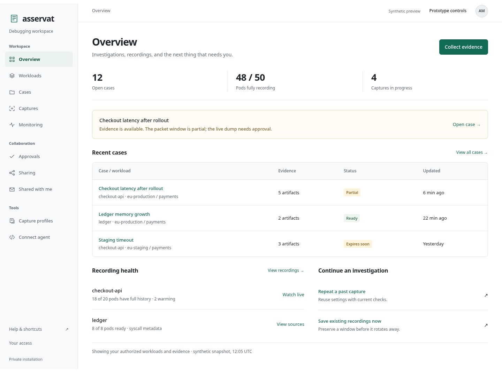
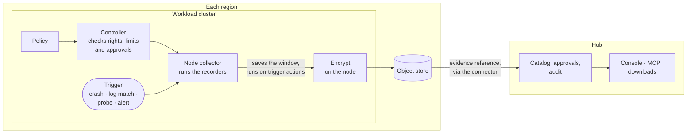
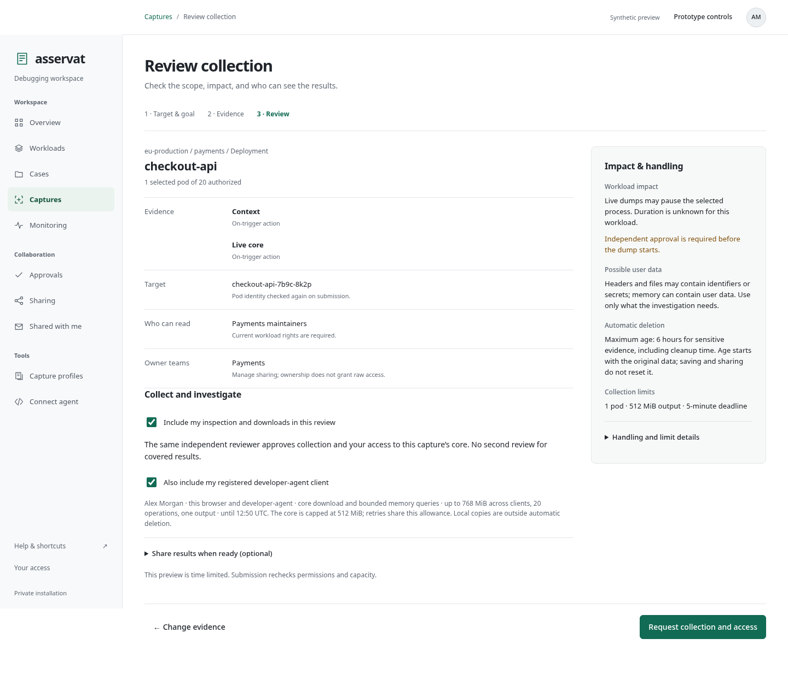
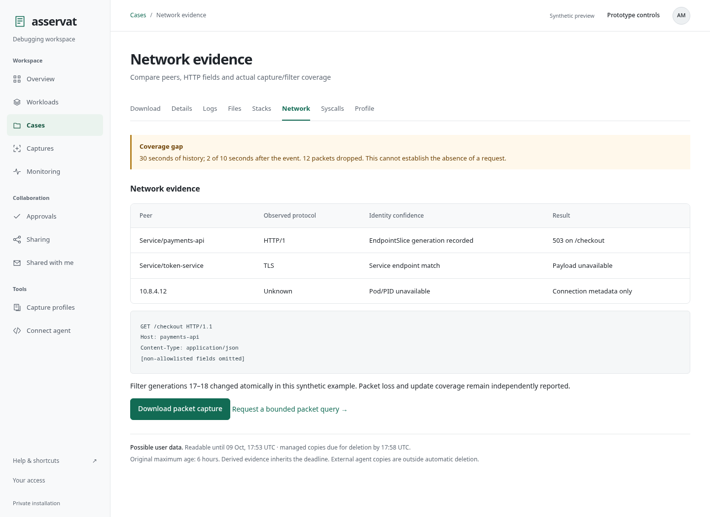
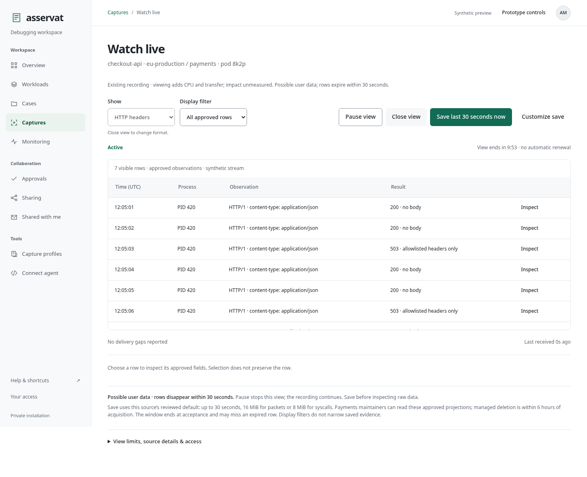
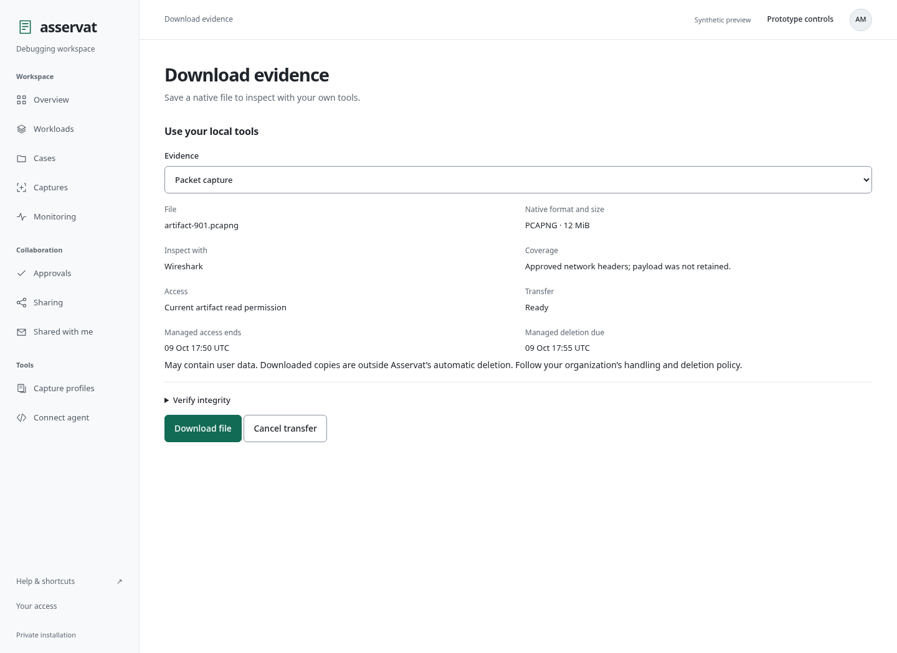

# Asservat

**Catch the evidence before the pod restarts.** Asservat records packet captures,
core dumps, profiles and logs from failing Kubernetes pods, for developers and
their AI agents.

[](https://github.com/phihos/asservat/actions/workflows/ci.yml)

> [!WARNING]
> **Early development: no supported release yet.** Installed tests cover
> pod-status investigation and bounded manual packet capture with real services.
> A supported homelab release and the broader continuous-recording, profiling
> and crash workflows remain unfinished. See [implementation status](docs/implementation-status.md).


<sub>Design prototype with synthetic data.</sub>

## What you can capture

A pod restart often destroys the evidence you need. Asservat captures it on the
pod while the problem happens and gives you each piece in its standard format:

| Evidence | What you get | Recorded |
| --- | --- | --- |
| Pod state | Phase, readiness, container counts and restarts, as JSON | On trigger |
| Logs | Container logs around the trigger, over a window you set | On trigger |
| Packet capture | PCAPNG filtered with tcpdump syntax; peers named by Kubernetes Service and Pod. Packet headers by default, full payloads with payload approval | Continuously |
| HTTP headers | Header fields you allow, as JSON, for live views and AI agents without payload approval. Bodies come with the full packet capture | Continuously |
| Core dump | ELF core, plus the matching executable and libraries when available | On trigger |
| Runtime profile | CPU profiles for Go, Java, Python, Node.js, .NET, Ruby, PHP and native code, sampled from the kernel without touching the process; heap, allocation and lock profiles for Go and Java | On trigger |
| Syscall trace | System calls with timing and results; argument memory is not read by default | Continuously |
| Files and commands | Files and `/proc` entries from the pod, and the output of commands you define | On trigger |

**Continuously:** the recorder keeps a rolling buffer, so a trigger saves the
seconds before it as well as after. **On trigger:** the action runs when the
trigger fires.

## Why Asservat

- **Captures on its own.** A policy triggers on log patterns, failed probes,
  crashes, resource thresholds or external alerts.
- **Built for AI coding agents.** Agents find and query evidence over MCP (Model
  Context Protocol), with your permissions.
- **Uses your Kubernetes permissions.** Access is granted with Kubernetes
  resources and can be inherited from namespace ownership or pod-exec rights.
- **Safe in production.** Per-workload size and rate limits, approval for
  intrusive captures, encryption on the node and retention limits set by
  administrators. Workloads keep Pod Security `restricted`.
- **Watch live.** Follow a running packet or syscall recording and save it
  before the rolling buffer overwrites it.
- **Shows what it missed.** Each capture reports dropped packets, truncation and
  other gaps, and each download carries its SHA-256 checksum.
- **Self-hosted.** One installation serves many clusters. No telemetry, SaaS or
  licence keys.

## How it works

A policy in the workload cluster says what to record and when. Node collectors
keep the continuous recorders running; when a trigger fires, they save the
recorder window and run the on-trigger actions. Evidence is encrypted on the node
and stays in its region's object store. The hub keeps only the catalog,
approvals and audit log, and each cluster's connector dials out to it.



Read more in [architecture](docs/architecture.md) and the
[security model](docs/security.md).

## A look at the console

<table>
  <tr>
    <td width="50%"><br><b>Review before collecting:</b> impact, possible user data, retention and readers.</td>
    <td width="50%"><br><b>Network evidence</b> with named peers and the gaps in the capture.</td>
  </tr>
  <tr>
    <td width="50%"><br><b>Live view</b> of HTTP headers from an ongoing recording.</td>
    <td width="50%"><br><b>Download</b> of a packet capture for Wireshark.</td>
  </tr>
</table>

<sub>Design prototype with synthetic data. [Try the prototype](docs/ux/README.md) in your browser; it has 63 screens.</sub>

## Example: capture evidence when a pod panics

This policy uses the planned format; you cannot apply it yet. It watches the
`api` Deployment with the `workload-failure` preset:

```yaml
apiVersion: asservat.io/v1alpha1
kind: DebugPolicy
metadata:
  name: api-failures
  namespace: payments
spec:
  presetRef:
    name: workload-failure
    version: v1
  target:
    workloadRef:
      kind: Deployment
      name: api
  logPattern:
    match: literal
    value: 'panic:'
```

When an `api` pod restarts, fails its liveness probe or logs `panic:`, Asservat
saves up to 13 MiB of encrypted evidence with the preset's defaults: the pod's
Kubernetes state and events, process status, network sockets, and logs from 30
seconds before to 10 seconds after the trigger.
[More examples](examples/README.md) add packet captures, profiles and core dumps.

## Learn more

- [Implementation status](docs/implementation-status.md): what works, how it is tested and what is missing
- [Product definition](docs/product.md): users, workflows and first-release scope
- [MCP workflows](docs/interfaces/mcp-workflows.md): what an AI agent can do, tool by tool
- [Helm installation](docs/installation/helm.md): what the chart installs today
- [Decision records](docs/decisions/README.md): every accepted design decision and why
- [Project guide](docs/project-guide.md): reading map, specifications and checks for contributors

## Contributing and license

Read the [contributing guide](CONTRIBUTING.md) before opening a pull request, and
ask questions in [GitHub issues](https://github.com/phihos/asservat/issues).
Asservat is licensed under the [Apache License 2.0](LICENSE).
