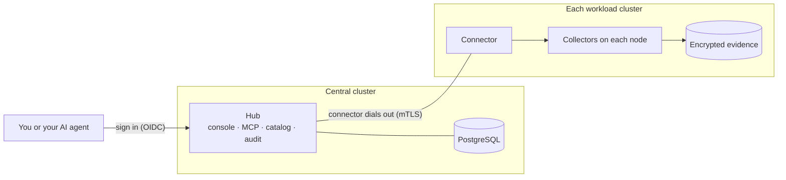

# Asservat

**Catch the evidence before the container restarts.** Asservat records packet captures,
core dumps, profiles and logs from failing Kubernetes pods, for developers and
their AI agents.

[](https://github.com/phihos/asservat/actions/workflows/ci.yml)

> [!WARNING]
> **Early development: not usable yet.** Sign-in, permission checks, encrypted
> storage, downloads and a small pod-status capture pass tests against real
> Kubernetes, PostgreSQL, OpenBao and S3. The other evidence types in the
> following table are partly built or only designed, and there is no release. See
> [implementation status](docs/implementation-status.md).


<sub>Design prototype with synthetic data.</sub>

## What you can capture

When a container restarts, its process memory, `/proc` state and the files it
wrote outside its volumes are gone. When the pod is replaced, its `emptyDir`
volumes go too, memory-backed ones included. Network traffic and system calls
are never stored unless something records them. Asservat captures this evidence on the pod
while the problem happens, and you get each piece as an ordinary file for the
tool you already use:

| Evidence | What you get | Open it with | Status |
| --- | --- | --- | --- |
| Pod state | Phase, readiness, container counts and restarts, as JSON | Console, any JSON tool | Tested |
| Logs | Container logs from 30 s before to 10 s after the trigger | Any text tool | Designed |
| Packet capture | PCAPNG filtered with tcpdump syntax; peers named by Kubernetes Service and Pod | Wireshark, tcpdump | Designed |
| HTTP headers | Header fields you allow, from captured HTTP traffic, as JSON; never bodies | Console, `jq` | Designed |
| Core dump | ELF core, plus the matching executable and libraries when available | GDB, LLDB or another debugger | Designed |
| Runtime profile | Go CPU, heap and mutex profiles and execution traces from the pod's pprof endpoint | `go tool pprof`, `go tool trace` | Partly built |
| Syscall trace | System calls with timing and results; argument memory is not read by default | Console, AI agent queries | Designed |
| Files and commands | Files and `/proc` entries from the pod, and the output of commands you define | Any tool | Designed |

Packet and syscall recorders can run continuously in a rolling buffer, so when a
trigger fires, the saved recording also covers the seconds *before* it. Every download shows its
SHA-256 checksum and states what the capture missed. *Tested*: passes tests
against real services. *Partly built*: acquisition works, the end-to-end path
does not.

## Why Asservat

- **Captures on its own.** A policy triggers on log patterns, failed probes,
  crashes, resource thresholds or external alerts.
- **Built for AI coding agents.** Agents find and query evidence over MCP (Model
  Context Protocol), with your permissions. Asservat contains no AI model.
- **Uses your Kubernetes permissions.** Access follows namespaces, RBAC and
  pod-exec rights; manage it with `kubectl` or GitOps.
- **Safe in production.** Per-workload size and rate limits, approval for
  intrusive captures, encryption on the node and retention limits set by
  administrators. Workloads keep Pod Security `restricted`.
- **Watch live.** Follow a running packet or syscall recording and save the last
  30 seconds.
- **Self-hosted.** One installation serves many clusters. No telemetry, SaaS or
  licence keys.

## How it works

Evidence is encrypted on the node and stays in the cluster where it was
captured. The central hub keeps the catalog, approvals and audit log. Each
cluster's connector dials out to the hub, so the hub needs no credentials for
your clusters.



Read more in [architecture](docs/architecture.md) and the
[security model](docs/security.md).

## A look at the console

<table>
  <tr>
    <td width="50%"><br><b>Review before collecting:</b> impact, possible user data, retention and readers.</td>
    <td width="50%"><br><b>Network evidence</b> with named peers and the gaps in the capture.</td>
  </tr>
  <tr>
    <td width="50%"><br><b>Live view</b> of HTTP headers from an ongoing recording.</td>
    <td width="50%"><br><b>Download</b> of a packet capture for Wireshark.</td>
  </tr>
</table>

<sub>Design prototype with synthetic data. [Try the prototype](docs/ux/README.md) in your browser; it has 63 screens.</sub>

## Example: capture evidence when a pod panics

This policy uses the planned format; you cannot apply it yet. It watches the
`api` Deployment with the `workload-failure` preset:

```yaml
apiVersion: asservat.io/v1alpha1
kind: DebugPolicy
metadata:
  name: api-failures
  namespace: payments
spec:
  presetRef:
    name: workload-failure
    version: v1
  target:
    workloadRef:
      kind: Deployment
      name: api
  logPattern:
    match: literal
    value: 'panic:'
```

When a container in an `api` pod restarts, fails its liveness probe or logs
`panic:`, Asservat saves up to 13 MiB of encrypted evidence: the pod's
Kubernetes state and events, process status, network sockets, and logs from 30
seconds before to 10 seconds after the trigger. [More examples](examples/README.md)
add packet captures, profiles and core dumps.

## Learn more

- [Implementation status](docs/implementation-status.md): what works, how it is tested and what is missing
- [Product definition](docs/product.md): users, workflows and first-release scope
- [MCP workflows](docs/interfaces/mcp-workflows.md): what an AI agent can do, tool by tool
- [Helm installation](docs/installation/helm.md): what the chart installs today
- [Decision records](docs/decisions/README.md): every accepted design decision and why
- [Project guide](docs/project-guide.md): reading map, specifications and checks for contributors

## Contributing and license

Read the [contributing guide](CONTRIBUTING.md) before opening a pull request, and
ask questions in [GitHub issues](https://github.com/phihos/asservat/issues).
Asservat is licensed under the [Apache License 2.0](LICENSE).
