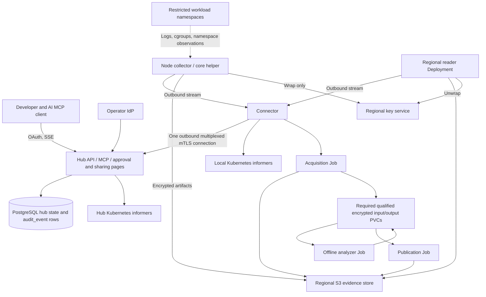

# Architecture

Status: proposed engineering design incorporating the [accepted decisions](decisions/README.md). The [implementation architecture](architecture/README.md) is the detailed application/component/module/interface map; its catalog is the canonical ownership and dependency inventory.

## Topology and boundaries

One **hub** runs in a management Kubernetes cluster. Each enrolled workload cluster runs a **connector**, node collectors with the embedded Inspektor Gadget runtime, a long-running **regional reader** and isolated analysis Jobs. Each installation serves one organization and manages its enrolled clusters. Teams and users receive namespace/workload permissions and explicit evidence shares. AccessBindings in application namespaces ([ADR-329](decisions/329-accessbindings-in-application-namespaces.md)) and administrator-managed PermissionSources feed one authorization service; the Kubernetes API is their sole configuration interface for kubectl, GitOps and provisioners. There is no tenant entity, tenant provisioning, or tenant routing; unrelated organizations use separate installations. Namespace eligibility remains explicit. Mechanisms follow [ADR-330](decisions/330-event-driven-system-design.md).

Default locality: managed raw artifacts, keys, symbols and analysis stay in their collection region. The hub stores authorized catalog metadata and audit rows. Downloads and bounded stored-evidence queries are served by the regional reader over the connector connection; optional extract caching at the hub requires an administrator-configured locality policy. Returning a bounded result or an explicitly authorized native-file download is an intentional audited disclosure. Every download relay location must be permitted; the hub has no unwrap key or durable raw cache. The UI makes the destination boundary explicit in the grant and explains external local copies.

The hub never holds workload-cluster kubeconfigs. Each connector holds one outbound, multiplexed mTLS connection to the hub ([connector identity](architecture/connector-credentials.md)); commands, cluster-state pushes, live rows and download bytes are streams on it. The connector pushes changed namespaces, workloads, Pods, EndpointSlices, AccessBindings and permission sources ([cluster observations](architecture/cluster-observations.md)). Kubernetes API access, Gadget access and node credentials remain local. A hub compromise remains consequential: it can request actions within the locally installed ceiling, which cluster administrators control and the hub cannot broaden.

## Components

| Component | Deployment and authority | Responsibilities |
| --- | --- | --- |
| Hub API/MCP | Unprivileged Deployment, horizontally replicated | OIDC/OAuth validation, authorization, case discovery, explicit sharing, connector connections, SSE progress; no node access |
| Hub workers | Unprivileged Deployment; work claimed with `FOR UPDATE SKIP LOCKED`, woken by `LISTEN/NOTIFY` | Sharing and lifecycle work, retention deadlines, audit export, webhook delivery |
| Connector | Unprivileged Deployment per cluster, leader-elected connection | Informers and pushes, workload resolution, local ceilings and permits, SubjectAccessReview, capture state, analysis Jobs |
| Node collector | Privileged DaemonSet in collector namespace | CRI identity cache, logs/cgroups, controlled files/process access, recipe execution, packet/syscall rings, encrypt/upload |
| Core pipe helper | Tiny static host-installed executable | Validate invocation, identify the process, connect to local collector, enforce elapsed/byte limits, exit promptly; no network/KMS SDK |
| Inspektor Gadget | Embedded in the collector | Packet/syscall observation; only approved gadget mechanisms and local node-scoped outputs |
| Regional reader | Long-running unprivileged Deployment per region, scaled by replicas | Native downloads (range reads), bounded stored-evidence queries, publication checks of envelope, manifest and index |
| Acquisition/publish workers | Short-lived unprivileged Jobs for offline analysis only | Stage exact artifacts/symbols/rootfs; later encrypt and publish analysis outputs |
| Offline analyzer | No-network Job, no service account token | Parse one artifact and inert target files with bounded tools |
| Index builder/query cache | Bounded regional component; hub only within explicitly permitted locality | Rebuild approved projections from object manifests; accelerate search; never authorize access |
| Infrastructure providers | Qualified PostgreSQL, S3, key and identity capabilities; optional private registries | Reuse existing infrastructure or explicitly selected internal/bundled alternatives under [ADR-063](decisions/063-small-deployment-alternatives.md) |

Use one `asservat` Go binary with role subcommands as defined in [applications](architecture/applications.md). Keep separate service accounts and images where privilege/tool content differs. The Rust helper is a separate artifact. Roles separate authority; they are not a requirement for many always-running services.

## Authoring and privacy resolution

The browser and Kubernetes collection resources converge on one authenticated resolver. Versioned presets supply routine defaults. A preview is a dry run that returns the resolved plan and its `plan_digest`; submission carries an idempotency key and `expected_plan_digest` and either accepts that plan or reports what changed. Source permission, resolved target, recipe/plan digests, local collection ceiling and privacy policy are checked once at admission. Effective-access explanation is a query over this evaluator, not a duplicate permission CRUD service.

Collection resolves retention policies and stores the effective deletion deadline on each artifact row before any evidence copy is written. A retention policy event applies a shorter deadline with one set-based SQL update; deletion runs from the stored deadlines, also locally through hub outages. New collection requires a current compatible policy. See [privacy](../specs/privacy.md), [retention lifecycle](architecture/retention-lifecycle.md) and [workflows](../specs/ergonomics.md).

The shared planner also computes [workload impact and data handling](../specs/capture-assessment.md) from the normalized plan, reviewed offline mechanism rules and existing authorized telemetry. It performs no experimental collection during preview. UI, MCP and GitOps project the same warnings; current node checks remain authoritative.

## Collection-time sharing

Optional sharing on DebugCapture/DebugPolicy passes through the same resolver and authenticated submitter checks. The accepted capture or policy stores its sharing instruction in SQL: immutable creator, managing owner teams (stable group IDs), recipients, approved output projections, expiry and limits. A sharing outage can leave collection usable to its normal audience without claiming that results will be shared.

When an artifact is published, the publication transaction inserts the matching concrete EvidenceShare rows with their audit rows. Parent revocation/expiry is checked on every dependent read. All evidence stays in its regional store and sharing does not extend retention. See [sharing requirements](../specs/authorization.md#req-shr-004--share-results-when-requesting-collection).

## Resource admission and storage isolation

Signal observation is separate from collection admission. One workload account spans replicas, policy revisions and request paths. Quotas are per-workload counters changed with conditional SQL updates that lock only the affected workload row (plus one pool row when burst applies). Each effect carries an operation ID; a retry returns the existing outcome, and a reservation settles to actual usage when the outcome is known. The hub grants each connector a budget lease for natural cores and disconnected work. No broker is required. See [capacity](../specs/capacity.md).

Node-local admission precedes a live pause or natural-core stream acceptance. CPU/scratch limits, fair upload/analysis queues and bounded retention-aware spools keep a slow backend from becoming an unbounded workload stall. Dropped/suppressed attempts remain visible as aggregated counts. Storage allocation does not prove physical disk capacity: backend qualification and explicit capacity ownership are part of readiness.

## Configuration, transactional state and evidence

Kubernetes holds declarative configuration; status uses `metadata.generation`/`status.observedGeneration` and conditions. CRDs should remain below 64 KiB and must remain below 128 KiB; no raw evidence, per-attempt or per-delivery objects. PostgreSQL holds executions, plans, settings, grants, shares, quota counters, catalog rows, small metadata and `audit_event` rows. Regional object storage holds envelope-encrypted evidence and full manifests. Field authority, tables and locking are normative in [hub persistence](../specs/persistence.md). There is one production SQL backend and no second permission-configuration API.

Short SQL transactions coordinate related hub state. Hub processes signal each other with `NOTIFY` in the writing transaction and catch up with one query after reconnecting. Remote side effects are resolved by operation ID; PostgreSQL does not guarantee exactly-once process actions.

SQL serves the content-minimized structured catalog. Regional Bleve caches may serve bounded full-text extracts under evidence deadlines; neither their content nor full manifests enter ordinary PostgreSQL backups. Search results/counts always pass current authority. Grant spend, revocations and pending reservations require qualified backup/recovery.

A security-relevant operation writes one append-only `audit_event` row in the same transaction as its effect and fails if the row cannot be written. Rows are exported in batches to the object store or a SIEM; retention drops whole time partitions ([operation audit](architecture/operation-audit.md)). Ordinary S3 or SQL administrator privileges do not supply tamper-proof storage; Object Lock on exported batches is optional.

## Collection path

1. The operator creates an `EvidenceRecipe` and `DebugPolicy`, or an authorized user submits an ad hoc `DebugCapture` or a browser/MCP request.
2. Admission validates shape and static limits; Kubernetes RBAC authorizes CRD writers and the audit log attributes them ([permission management](../specs/permissions.md)). The hub authorizes the operation once, checks namespace opt-in, workload rights, recipe digest, local ceiling and grants, reserves capacity and stores the accepted plan with its audit row.
3. The hub sends the work over the connector connection (`Queued → Sent → Running`, resent on reconnect, deduplicated by work ID). The node collector reports its actual capabilities; unavailable actions stay visible as degraded capability.
4. Sensors run locally. A trigger emits a unique occurrence ID; after incident capacity/authority admission it pins the admitted window from the already armed ring. The start is recorded in a `capture_start` row keyed by operation ID, so a retry never starts it twice.
5. Each action runs within its admitted reservation covering workload/node impact, scratch, transfer and stored bytes/object slots. Independent low-impact snapshots run concurrently within node budgets; incompatible process-pausing actions serialize. Outcomes include unavailable, denied, partial and lost-target states.
6. Evidence is compressed where appropriate, validated against its native format, encrypted on the node with a unique streaming keyset and uploaded to regional S3 with streamed SHA-256 checksums. Local disk is not a completed upload.
7. The regional reader verifies the commit envelope and checks the manifest and index against the stored expectation; the hub publishes in one SQL transaction (catalog row, stored deadlines, charge settled to actual size, audit row, NOTIFY). Data frames are authenticated by AEAD on every read ([context publication](architecture/context-publication.md)).
8. Permitted offline analysis runs as acquisition, analyzer and publication Jobs. A case is useful before every action finishes.

When the node disappears, pre-trigger RAM and incomplete streams can be lost. Report the gap. An upload retried after reconnect reuses its operation's object key; orphaned multipart uploads are aborted by the bucket lifecycle rule.

## Identity and process access

Bind a process to `(clusterUUID, nodeUID, nodeBootID, podUID, containerID, restartCount, hostPID, processStartTime)` and pin available pidfds/namespace descriptors. Resolve Deployment ownership through ReplicaSets, and StatefulSet ownership through controller UIDs and ordinal metadata. A reused PID, pod name, IP, or container name never authorizes a new target.

The CRI socket is effectively powerful host access even when mounted read-only. Isolate it in the node collector, expose no generic CRI proxy, and use only explicit identity/exec methods. A provider without a supported runtime adapter reports missing capabilities. HostNetwork and user-namespace workloads need their own qualification.

Use three separate file-access modes: container-root files, target-process `/proc` snapshots, and approved runtime-generated files. Do not conflate a collector's `/proc/self` with the target's. Path confinement, magic-link handling and mount/PID namespace semantics are specified in [actions](../specs/actions.md).

## Core interception

The host-path executable is necessary because the kernel launches the pipe handler in the initial mount namespace. Install atomically into an explicitly supported writable host path; record original pattern/ownership; activate only when the helper and node service are ready. Avoid competing writers: if a different manager changes the pattern, mark `CorePatternConflict` and stop automatic overwrites until the administrator resolves ownership.

The helper authenticates its local socket peer and provides only kernel-supplied numeric IDs plus validated process identity. The collector applies opt-in/deny rules, reserves a byte/time/concurrency budget and consumes already prepared single-use encryption material before accepting the stream, as specified below; it never waits for remote preparation. On failure, close promptly and record loss if possible. Do not enqueue an unbounded process-reaping delay. No shell expansion of process-controlled names.

Uninstall restores the prior pattern only if the current pattern still belongs to Asservat; drain helpers before removing the executable. A node replacement creates an observable coverage gap until readiness. A DaemonSet cannot provide an absolute boot-time crash guarantee. [Linux execution semantics](https://man7.org/linux/man-pages/man5/core.5.html).

## Disconnection and revocation

A started source runs to its admitted hard end: policy expiry, binding `notAfter`, grant, local ceiling or session length. Revocation, Stop and retention tightening reach it as pushed events over the connector connection; a pending stop is delivered on reconnect. While disconnected, natural cores and policy triggers start only under the connector's budget lease and unexpired local policy permits; a reconnect never extends a source. Raw MCP access and shared evidence queries fail closed if current authorization cannot be established. An existing artifact upload can finish after revocation to preserve already acquired evidence.

## Failure choices

| Failure | Required behavior |
| --- | --- |
| KMS unavailable | No plaintext upload. Reject new collection that lacks a valid pre-wrapped per-artifact key; emit a content-free loss reason. |
| PostgreSQL unavailable | No new central authority/disclosure; local execution under the budget lease and unexpired permits, and local retention, continue. |
| S3 unavailable/slow | Bounded encrypted buffering; fail partial or abort before node/process deadlines. No implicit unlimited retry. |
| Hub unavailable | Started sources run to their hard ends; local starts only within the budget lease and permits; regional evidence survives; the hub catches up on reconnect. |
| Local Kubernetes API unavailable | Informer caches stay valid but marked stale on watch failure; no new intrusive start that needs an unavailable source. |
| Grant update race | Conditional update fails; re-read authorization. Never decrement/reuse a budget in memory only. |
| Lost reply | Retry with the same operation ID returns the existing outcome; nothing runs twice. |
| Analyzer crashes | Preserve raw artifact and failure reason; retry a bounded number of times using the same input digest. |
| Deletion deadline missed | Deny expired access, report outstanding copies and retry; pause new collection into the affected allocation. |
| Namespace/workload removed | No cascading deletion of evidence; stored deadlines drive cleanup. No collection of a same-name replacement. |
| Shared recipient loses group membership | No new disclosure after the reused authorization (at most 30 s) ends. |
| Core pattern conflicts | Disable that capability and notify, do not fight another crash manager. |

Detailed state machines and contracts are in [APIs](../specs/apis.md), [evidence](../specs/evidence.md), and [authorization](../specs/authorization.md).

## Network evidence pipeline

Pinned Gadget hooks feed node-local bounded filters, membership generations and sanitizers/parsers. Dynamic Kubernetes peer resolution updates maps without restarting healthy hooks; target attach and packet loss gaps remain visible. The selected representation enters a segmented encrypted ring, then separately reserved frozen snapshots/upload. Plain HTTP/1 headers use bounded reassembly and a reviewed projection before retention; raw packet prefixes require their own approval. No raw live packet stream transits the hub. An authorized saved-artifact download is a separate bounded authenticated relay under [the download contract](../specs/artifact-downloads.md). See [packet design](../specs/packets.md).

Public targeting and permission end at pods; runtime container identity remains internal. Observe all authorized replicas under sensor ceilings and select contributing pods separately for capture. Logical process selectors resolve current matches at dispatch, then each bounded serial dump attempt pins its identity. [Execution scopes](../specs/execution.md) separate submission/collection/sharing digests, and per-action approval waiting preserves independent context. Sensitive packet observation has its own cumulative session budgets. Initial text indexes are bounded memory caches; persistent expiry cohorts and SQL backup horizons require the [copy-retention controls](../specs/privacy.md#req-prv-008--backup-horizons-and-expiring-index-segments).

## Guided planning path

The hub's catalog/planning service hosts a deterministic, versioned recommendation evaluator. Browser and MCP use the same evaluator and plan compiler. Discovery runs through normal DebugCapture acceptance and node recipes; isolated regional analyzers publish approved process/flow projections. The evaluator reads only authorized projections and capability metadata and returns stateless plans with their `plan_digest`. Evidence-bearing drafts stay in the region under finite expiry; SQL holds bounded control rows, not sampled traffic, executable paths or flow lists. No new CRD, permission service, embedded LLM or separate survey execution API is introduced. See [guidance](../specs/guidance.md).

## Capture-profile compilation

CaptureProfile is declarative Kubernetes configuration; the connector pushes namespace profiles to the hub. A shared deterministic compiler resolves versioned definitions and typed edits to the existing evidence recipe DAG; no additional service, embedded interpreter or database is needed. Accepted plans bind dependencies and namespace action/endpoint identities, deduplicate only independent context and apply aggregate admission. Syscall tracing extends the qualified Gadget adapter and existing encrypted artifact/analysis pipeline. [Composition](../specs/capture-profiles.md) and [syscall semantics](../specs/syscalls.md) specify the boundaries.

## Separate recorders from incident jobs

The execution planner splits recipes into ongoing source sessions and per-incident saves/onTrigger jobs. Node collectors own authorized rolling sources, admitted once at arming and run to their hard end; an admitted occurrence references matching source sessions and independently dispatches snapshots/dumps. Separate arming and snapshot reservations prevent per-trigger recorder duplication. Source status, finite manual sessions and crash-event acquisition follow [action lifecycles](../specs/action-lifecycle.md).

## Natural-core readiness without remote crash-path waits

Before reporting interception ready, the node service prepares a finite pool of single-use encryption envelopes (fresh data key per artifact, already wrapped by the regional key service) and holds a share of the connector's budget lease and valid local permits. Key material stays in bounded protected memory. A pool entry is single-use and is discarded, never reused, after collector-state loss. Replenishment happens outside the crash acceptance path.

The Rust pipe helper performs bounded local handoff only. It never calls Kubernetes, SQL, KMS, DNS, object storage or the hub while holding a crashed process. Local admission consumes one prepared envelope and lease share before accepting evidence. An absent envelope, exhausted lease or unavailable local receiver causes prompt bounded refusal with a content-free reason; no synchronous remote refill or plaintext fallback. The connector reports the outcome by operation ID on its connection, and the hub writes the audit row and settles the lease. Fault injection must demonstrate bounded crash delay when every remote service is down.

The [disposable-VM spike](research/feasibility-control-crash.md) demonstrated this local handoff with memory-only test keys and native GDB opening; it did not implement wrapped keys or Kubernetes authority. One absolute deadline covers connect/handshake/read/write/finalization, stream completion is separate from admission, and helper cgroup placement needs its own qualification.

## Save existing recordings now

An explicitly enabled/reviewed policy can accept a narrow manual save from a currently authorized maintainer. Preview resolves the current packet/syscall sources and returns a `plan_digest`; the existing capture submit service creates one recordingSave execution with immutable t0, scope digest and independent snapshot references. The original policy executor/source authority and current requester scope are both checked. The snapshot dispatcher cannot traverse the policy recipe DAG or start onTrigger actions. Existing admission, capacity, encryption/publication, cancellation, history and per-capture sharing apply; recurring-sharing instructions are not inherited.

## Live observation path

[Live watching](../specs/live-watch.md) adds an optional consumer of already authorized packet/syscall sources: existing source → qualified bounded projection → stream on the connector connection → hub → browser SSE stream or MCP `read_live_watch`. No inbound node port, public raw-stream endpoint or broker. [Internal interfaces](architecture/interfaces.md) separate durable control from transient live exchange. Direct live queries are distinct from object-backed artifact analysis and cannot open a source.

A LiveWatch is an SQL control row (filter, revision, deadline, charges); row and replay payloads stay bounded transient memory. Strict fanout/scan/output caps, per-view filtering and source-cohort isolation prevent a broad reader from exposing another principal's rows. The watch is authorized once and reused within ADR-311; access changes reach it as pushed events. Regional evidence policy also governs transient routing: if approved extracts may not cross a region, the hub must route within that boundary or refuse the view.

Shed or disconnect live readers under pressure before protected snapshot/publication work. Acquisition rings and live replay buffers have separate reservations; no reader pins raw segments. Loss, restart/failover and source replacement are observable gaps or terminal states. The hub replica that holds the connector connection carries the stream; after a replica loss the watch resumes from current source heads with an explicit gap. No reconnect extends source or watch authority. Saving uses the recording-save pipeline; there is no automatic live-event persistence.

## Implementation boundaries

The [architecture catalog](architecture/catalog.yaml) assigns all requirements and domain entities to lifecycle owners and defines permitted dependencies. [Components](architecture/components.md) specify transaction facets; [runtime walkthroughs](architecture/runtime.md) distinguish accepted work, acquisition and verified commit/deletion. [Code organization](architecture/code-organization.md) defines the package layout. [Implementation slices](architecture/implementation-slices.md) order the work.

Collectors use typed ports to the local connector rather than a generic Kubernetes writer. Work travels over the mTLS connector connection without signatures; each effect has a stable operation ID, and a retried or resent command cannot authorize a second intrusive start.
