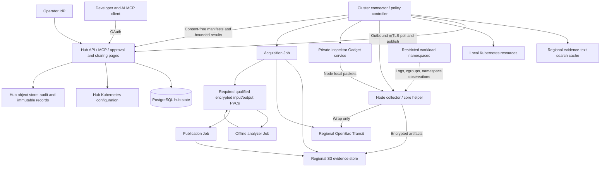

# Architecture

Status: proposed engineering design incorporating the [accepted decisions](decisions/README.md). The [implementation architecture](architecture/README.md) is the detailed application/component/module/interface map; its catalog is the canonical ownership and dependency inventory.

## Topology and boundaries

One **hub** runs in a management Kubernetes cluster. Each enrolled workload cluster runs a **cluster connector/controller**, node collectors, the selected Inspektor Gadget components, and isolated analysis Jobs. Each installation serves one organization and manages its enrolled clusters. Teams and users receive namespace/workload permissions and explicit evidence shares. Protected AccessBindings and configurable PermissionSources feed one authorization service; the Kubernetes API is their sole public configuration interface for kubectl, GitOps and provisioners. There is no tenant entity, tenant provisioning, or tenant routing; unrelated organizations use separate installations. Namespace eligibility remains explicit.

Default locality: managed raw artifacts, keys, symbols and analysis stay in their collection region. The hub stores authorized catalog metadata and encrypted audit records. Extracts remain in the evidence store and are fetched through the cluster connector on demand; optional extract caching at the hub requires an administrator-configured locality policy. Returning a bounded result or an explicitly authorized native-file download to a developer/client is an intentional audited disclosure. Every download relay location must be permitted; the hub has no unwrap key or durable raw cache. The UI makes the destination boundary explicit in the grant and explains external local copies.

The hub never holds arbitrary workload-cluster kubeconfigs. Connectors establish outbound TLS connections using short-lived cluster certificates and pull signed work. Kubernetes API access, Inspektor Gadget access and node credentials remain local. A hub compromise remains consequential: it can request actions within the locally installed ceiling. The local ceiling is controlled by cluster administrators and cannot be broadened remotely.

## Components

| Component | Deployment and authority | Responsibilities |
| --- | --- | --- |
| Hub API/MCP | Unprivileged Deployment, horizontally replicated | OIDC/OAuth validation, namespace/workload ACLs, case discovery, explicit sharing, bounded query dispatch; no node access |
| Hub reconciler | Deployment with leader leases | Enrollment, grant/share/SharingIntent lifecycles, catalog projection, outbox delivery, retention reconciliation |
| Cluster connector/controller | Unprivileged Deployment per cluster | Workload resolution, policy snapshots, local approval ceilings, durable capture state, analysis scheduling, hub synchronization |
| Node collector | Privileged DaemonSet in collector namespace | CRI identity cache, logs/cgroups, controlled files/process access, recipe execution, packet ring, encrypt/upload |
| Core pipe helper | Tiny static host-installed executable | Validate invocation, identify the process, connect to local collector, enforce elapsed/byte limits, exit promptly; no network/KMS SDK |
| Inspektor Gadget | Pinned private DaemonSet | Packet observation; only approved gadget digests and local node-scoped outputs |
| Acquisition/publish workers | Short-lived unprivileged Jobs with separate identities | Stage exact artifacts/symbols/rootfs; later encrypt and publish outputs |
| Offline analyzer | No-network Job, no service account token | Parse one artifact and inert target files with bounded tools |
| Index builder/query cache | Bounded regional component hosted with connector initially; hub only within explicitly permitted locality | Rebuild approved projections from object manifests; accelerate search; never authorize access |
| Infrastructure providers | Qualified PostgreSQL, S3, key and identity capabilities; optional private registries | Reuse existing infrastructure or explicitly selected internal/bundled alternatives under [ADR-063](decisions/063-small-deployment-alternatives.md); small-profile qualification pending |

Use one `asservat` Go binary with role subcommands `hub-api`, `hub-worker`, `controller`, `node`, `acquire`, `analyze` and `publish`, as defined in [applications](architecture/applications.md). Keep separate service accounts and images where privilege/tool content differs. The Rust helper is a separate artifact. This is separation of authority, not a requirement for nine always-running services.

## Authoring and privacy resolution

The browser and Kubernetes collection resources converge on one authenticated resolver. Versioned presets supply routine defaults; it persists a bounded accepted plan without rewriting user-owned spec. Source permission, resolved target, recipe/plan digests, local collection ceiling and privacy policy are independently verified before dispatch. Effective-access explanation is a query over this evaluator, not a duplicate permission CRUD service.

Retention policies propagate signed, short-lived snapshots to clusters. Record deadlines before writing any evidence copy, enforce them locally through hub outages, and keep full lineage/copy inventories and lifecycle outcomes in encrypted object storage. SQL holds content-minimized references and authoritative hub deletion work; local workers enforce storage deadlines. New collection requires a current compatible policy. Separately controlled retention/privacy decisions use bounded active control work and immutable outcome records, not one permanently retained CRD per copy. See [privacy](../specs/privacy.md) and [workflows](../specs/ergonomics.md).

The shared planner also computes [workload impact and data handling](../specs/capture-assessment.md) from the normalized plan, reviewed offline mechanism rules and existing authorized telemetry. It performs no experimental collection during preview and uses the current admission/privacy services. UI, MCP and GitOps project the same warnings; current node checks remain authoritative. Assessment freshness does not create another approval, configuration service or database.

## Collection-time sharing

Optional sharing on DebugCapture/DebugPolicy passes through the same resolver and authenticated submitter checks. A protected hub SharingIntent pins source identity/revision, immutable creator, managing owner teams, recipients, approved output projections, expiry and limits. Policy captures register idempotently before dispatch against a bounded slot; a sharing outage can leave collection usable to its normal audience without claiming that unregistered results will be shared.

After artifact commit and validated analysis, the hub materializer verifies acquisition/derivation provenance, current authority, per-selection approval and remaining deadlines. It adds matching concrete references to one EvidenceShare per intent/capture/selection through audited SQL revision checks. Hub registration, counters, snapshot revisions and outbox use SQL transactions; remote/object-store side effects still need conservative reconciliation. New publication waits for durable audit acknowledgment. Parent revocation/expiry is checked on every dependent read, independently of child cleanup. All evidence stays in its existing regional store and sharing does not extend retention. See [sharing requirements](../specs/authorization.md#req-shr-004--share-results-when-requesting-collection).

## Resource admission and storage isolation

Signal observation is separate from collection admission. One workload account spans replicas, policy revisions and request paths. Protected storage is allocated during enrollment; only a separately budgeted burst slice is shared. Parent cluster/namespace allocations and workload hard caps prevent one application or a proliferation of accounts exhausting another workload's protected capacity. Central CapacityAccount/CapacityReservation rows use SQL transactions, with prepaid local Kubernetes slices, encrypted object-store charge history and conservative reconciliation after failures. No broker is required. See [capacity](../specs/capacity.md).

Node-local admission precedes a live pause or natural-core stream acceptance. CPU/scratch guards, fair upload/analysis queues and bounded retention-aware spools keep a slow backend from becoming an unbounded workload stall. Dropped/suppressed attempts remain visible as aggregated counts. Storage allocation does not prove physical disk capacity: backend qualification and explicit capacity ownership are part of readiness.

## Configuration, transactional state and evidence

Kubernetes holds declarative configuration and bounded local execution/permit state. CRDs should remain below 64 KiB and must remain below 128 KiB; no raw evidence or unbounded history. PostgreSQL holds hub executions, grants, shares/intents, quota accounts, catalog associations and outbox work. Regional object storage holds encrypted evidence/full manifests and immutable occurrence/audit records. Field authority, logical tables, locking, audit gates and recovery are normative in [hub persistence](../specs/persistence.md). There is one production SQL backend and no second permission-configuration API.

Short SQL transactions coordinate related hub state. Source freshness, current IdP/SAR authority and local ceilings remain mandatory. Remote side effects are idempotent/fenced state machines; PostgreSQL does not guarantee exactly-once process actions. The hub does not dispatch sensitive work or disclose results until required object-store audit is durable.

SQL serves the content-minimized structured catalog. Regional Bleve caches may serve bounded full-text extracts under evidence deadlines; neither their content nor full manifests enter ordinary PostgreSQL backups. Search results/counts always pass current authority. SQL authority is not a disposable index: grant spend, revocations and pending reservations require qualified backup/recovery.

Audit records are individually durable before an access response or intrusive start is released. A final result record links its intent. Unpredictable object IDs and per-writer seals/checkpoints support integrity verification; qualified Object Lock is optional under finite retention. Ordinary S3 or SQL administrator privileges do not supply tamper-proof storage.

## Collection path

1. The operator creates an `EvidenceRecipe` and `DebugPolicy`, or an authorized user submits an ad hoc `DebugCapture`.
2. Admission validates shape and static limits and authenticates the submitter; the controller accepts only a verified submission/execution identity as specified in [permission management](../specs/permissions.md). The local controller verifies namespace opt-in, workload rights, recipe digest, local ceiling and grant requirements. It compiles a signed immutable plan.
3. The node collector acknowledges the plan and its actual capabilities. `Ready` requires fresh acknowledgements for targeted nodes; unavailable actions stay visible as degraded capability.
4. Sensors run locally. A trigger emits a unique occurrence ID; after incident capacity/authority admission it pins the admitted window from the already armed ring. A fenced local execution record binds target identity and plan digest under its prepaid permit; SQL records or later idempotently imports the accepted execution without repeating it.
5. Every action checks the live identity and grant/permit again, plus a Ready capacity reservation covering workload/node impact, scratch, fair transfer and stored bytes/object slots. Independent low-impact snapshots run concurrently within node budgets; incompatible process pausing actions serialize. Outcome includes unavailable, denied, partial and lost-target states.
6. Evidence is compressed where appropriate, encrypted on the node with a unique streaming keyset, uploaded to regional S3, and sealed by an immutable manifest. Local disk is not treated as a completed upload.
7. The local controller schedules permitted pre-analysis. The acquisition Job decrypts into scratch, stages exact symbols/rootfs, and finishes. A separate offline analyzer reads it; a publisher encrypts only approved outputs.
8. The connector publishes content-free occurrence/manifest references to the hub. Hub catalog and events reconcile independently of analysis success. A case can be useful before every action finishes.

When the node disappears, pre-trigger RAM and incomplete streams can be lost. Report the gap. Already completed immutable objects remain discoverable even if the capture status update was lost. Periodic reconciliation scans narrow prefixes to recover orphan commits and abort stale multipart uploads.

## Identity and process access

Bind a process to `(clusterUUID, nodeUID, nodeBootID, podUID, containerID, restartCount, hostPID, processStartTime)` and pin available pidfds/namespace descriptors. Resolve Deployment ownership through ReplicaSets, and StatefulSet ownership through controller UIDs and ordinal metadata. A reused PID, pod name, IP, or container name never authorizes a new target.

The CRI socket is effectively powerful host access even when mounted read-only. Isolate it in the node collector, expose no generic CRI proxy, and use only explicit identity/exec methods. A provider without a supported runtime adapter reports missing capabilities. HostNetwork and user-namespace workloads need their own qualification.

Use three separate file-access modes: container-root files, target-process `/proc` snapshots, and approved runtime-generated files. Do not conflate a collector's `/proc/self` with the target's. Path confinement, magic-link handling and mount/PID namespace semantics are specified in [actions](../specs/actions.md).

## Core interception

The host-path executable is necessary because the kernel launches the pipe handler in the initial mount namespace. Install atomically into an explicitly supported writable host path; record original pattern/ownership; activate only when the helper and node service are ready. Avoid competing writers: if a different manager changes the pattern, mark `CorePatternConflict` and stop automatic overwrites until the administrator resolves ownership.

The helper authenticates its local socket peer and provides only kernel-supplied numeric IDs plus validated process identity. The collector applies opt-in/deny rules, reserves a byte/time/concurrency budget and consumes already prepared single-use encryption material before accepting the stream, as specified below; it never waits for remote preparation. On failure, close promptly and record loss if possible. Do not enqueue an unbounded process-reaping delay. No shell expansion of process-controlled names.

Uninstall restores the prior pattern only if the current pattern still belongs to Asservat; drain helpers before removing the executable. A node replacement creates an observable coverage gap until readiness. A DaemonSet cannot provide an absolute boot-time crash guarantee. [Linux execution semantics](https://man7.org/linux/man-pages/man5/core.5.html).

## Disconnection and revocation

Ordinary opted-in observations may continue under a short local policy lease while the hub is unavailable. Intrusive actions require a previously issued local permit bounded by policy digest, cluster/node/action identity, maximum starts, aggregate bytes and expiry; permits expire within 60 seconds by default. Permit allocation reserves quota at the hub first. A collector restart without its authoritative local reservation state does not reuse a permit.

Revocation propagates immediately when connected and is bounded by permit expiry when disconnected. Offline mode therefore offers **bounded revocation delay**, not instantaneous global revocation. Raw MCP access and shared evidence queries fail closed if current authorization cannot be established. Existing artifact upload can finish after revocation to preserve already acquired evidence; acquisition stops at the next cancellation checkpoint.

## Failure choices

| Failure | Required behavior |
| --- | --- |
| KMS unavailable | No plaintext upload. Reject new collection that lacks a valid pre-wrapped per-artifact key; emit a content-free loss reason. |
| PostgreSQL unavailable | No new central authority/disclosure; bounded prepaid local execution and local retention continue. Recovery gates and primary fencing apply. |
| S3 unavailable/slow | Bounded encrypted buffering; fail partial or abort before node/process deadlines. No implicit unlimited retry. |
| Hub unavailable | Local collection within valid permits/ceilings; regional evidence survives; hub catalog catches up. |
| Local Kubernetes API unavailable | Existing sensor rings can continue under leases; no new intrusive execution without a durable reservation. |
| Grant update race | Compare-and-swap fails; re-read authorization. Never decrement/reuse a budget optimistically in memory only. |
| Analyzer crashes | Preserve raw artifact and failure reason; retry a bounded number of times using the same input digest. |
| Deletion deadline missed | Deny expired access, report outstanding copies and retry; pause new collection into the affected backed allocation; widen to the profile for backend-wide or unisolatable failure. |
| Namespace/workload removed | No cascading deletion of evidence; retention controller owns cleanup. No collection of a same-name replacement. |
| Shared recipient loses group membership | No new disclosure after the configured identity freshness bound; expired/failing revalidation denies. |
| Core pattern conflicts | Disable that capability and notify, do not fight another crash manager. |

Detailed state machines and contracts are in [APIs](../specs/apis.md), [evidence](../specs/evidence.md), and [authorization](../specs/authorization.md).

## Network evidence pipeline

Pinned Gadget hooks feed node-local bounded filters, membership generations and sanitizers/parsers. Dynamic Kubernetes peer resolution updates maps without restarting healthy hooks; target attach and packet loss gaps remain visible. The selected representation enters a segmented encrypted ring, then separately reserved frozen snapshots/upload. Plain HTTP/1 headers use bounded reassembly and a reviewed projection before retention; raw packet prefixes require their own approval. No raw live packet stream transits the hub. An authorized saved-artifact download is a separate bounded authenticated relay under [the download contract](../specs/artifact-downloads.md). See [packet design](../specs/packets.md).

Public targeting and permission end at pods; runtime container identity remains internal. Observe all authorized replicas under sensor ceilings and select contributing pods separately for capture. Logical process selectors resolve current matches at dispatch, then each bounded serial dump attempt pins its identity. [Execution scopes](../specs/execution.md) separate submission/collection/sharing digests, and per-action approval waiting preserves independent context. Sensitive packet observation has its own cumulative session budgets. Initial text indexes are bounded memory caches; persistent expiry cohorts and SQL backup horizons require the [copy-retention controls](../specs/privacy.md#req-prv-008--backup-horizons-and-expiring-index-segments).

## Guided planning path

The hub's existing catalog/planning service hosts a deterministic, versioned recommendation evaluator. Browser and MCP use the same evaluator and plan compiler. Discovery runs through normal DebugCapture acceptance and node recipes; isolated regional analyzers publish approved process/flow projections. The evaluator reads only authorized projections and capability metadata, returns existing-format diagnostic handles and stores bounded expiring evidence-bearing drafts in encrypted regional object storage. PostgreSQL retains opaque references, scope/digest/expiry and bounded control state, not sampled traffic, executable paths or flow lists. No new CRD, permission service, embedded LLM or separate survey execution API is introduced. See [guidance](../specs/guidance.md) for limits and lifecycle.

## Capture-profile compilation

CaptureProfile is declarative Kubernetes configuration distributed through the existing hub/connector projection path. A shared deterministic compiler resolves versioned definitions and typed edits to the existing evidence recipe DAG; no additional service, embedded interpreter or database is needed. Accepted plans bind dependencies, namespace action/endpoint identities, deduplicate only independent context and apply aggregate admission. Syscall tracing extends the qualified Gadget adapter and existing encrypted artifact/analysis pipeline. [Composition](../specs/capture-profiles.md) and [syscall semantics](../specs/syscalls.md) specify the boundaries.

## Separate recorders from incident jobs

The execution planner splits recipes into ongoing source sessions and per-incident saves/onTrigger jobs. Node collectors own fenced, authorized rolling sources; an admitted occurrence references matching source epochs and independently dispatches snapshots/dumps. Separate arming and snapshot reservations prevent per-trigger recorder duplication and pre-observation approval gaps. Source status, finite manual sessions and crash-event acquisition follow [action lifecycles](../specs/action-lifecycle.md).

## Natural-core readiness without remote crash-path waits

Before reporting interception ready, the node service prepares a finite pool of single-use encryption envelopes (fresh data key per artifact, already wrapped by the regional KMS), prepaid local capacity and valid local permits rooted in durable audited authorization. Key material stays in bounded protected memory. Pool entries have finite authority/deadlines, scope and crash-safe spent/uncertain state; restart discards uncertain or lost entries rather than reusing keys or refunding unproven spend. Replenishment happens outside the crash acceptance path.

The Rust pipe helper performs bounded local handoff only. It never calls Kubernetes, SQL, KMS, DNS, object storage or the hub while holding a crashed process. Local admission consumes one prepared envelope and reservation before accepting evidence. An absent/expired envelope, exhausted budget or unavailable local receiver causes prompt bounded refusal with a content-free reason; no synchronous remote refill or plaintext fallback. Child acquisition/outcome audit is linked later to the precommitted permit and reconciled spend. Natural crash interception is a distinct preauthorized local path, not a waiver of audit for an ad hoc live dump. Fault injection must demonstrate bounded crash delay when every remote service is down.

The [disposable-VM spike](research/feasibility-control-crash.md) demonstrated this local handoff with memory-only test keys, bounded failure cases and native GDB opening. It did not implement recoverable wrapped keys or Kubernetes authority. Its findings require one absolute deadline across connect/handshake/read/write/finalization, explicit stream completion separate from admission, and separately qualified helper cgroup placement. Keep production readiness blocked until the full envelope/spend/identity path and supported node profiles are qualified.

## Save existing recordings now

An explicitly enabled/reviewed policy can accept a narrow manual save from a currently authorized maintainer. Passive inventory and preview resolve current packet/syscall source handles; the existing capture submit service creates one recordingSave execution with immutable t0, scope digest and independent snapshot references. The original policy executor/source authority and current requester scope are both checked. The snapshot dispatcher cannot traverse the policy recipe DAG or start onTrigger actions. Use existing admission, capacity, encryption/publication, cancellation, history and per-capture sharing services. Automatic recurring-sharing instructions are not inherited. No new service, database, CRD or manual detector is introduced.

## Live observation path

[Live watching](../specs/live-watch.md) adds an optional consumer of already authorized packet/syscall sources: existing source → qualified bounded projection → regional connector stream → authenticated hub batch → browser/MCP viewer. Existing outbound TLS/mTLS enrollment and local ceilings remain; no inbound node port, public raw-stream endpoint or third broker. Nodes initiate private connector control requests; connectors initiate hub requests. [Internal interfaces](architecture/interfaces.md) separate durable control from transient live exchange. Direct live queries are distinct from object-backed artifact analysis and cannot open a source. Projection needs its own live qualification; an offline analyzer is not automatically a streaming parser.

Hub `LiveWatch` control rows and prepaid view reservations are durable enough for idempotency/accounting, but row/replay payloads remain bounded transient memory. Strict fanout/scan/output caps, per-view filtering and source-cohort isolation prevent a broad reader from exposing another principal's rows. Transfer of every batch requires current rights and unexpired row provenance; paused reads are status-only. Regional evidence policy also governs transient routing: if approved extracts may not cross a region, the hub endpoint must route/present within that permitted boundary or refuse the view. Viewing cannot silently bypass a data-residency rule.

Shed or disconnect live readers under pressure before protected snapshot/publication work. Acquisition rings and live replay buffers have separate reservations; no reader pins raw segments. Loss, restart/failover and source replacement are observable gaps or terminal states. Saving uses the existing immutable recording-save pipeline with fresh acceptance and actual source coverage; there is no automatic live-event persistence.

A LiveWatch has a leased, fenced projection owner recorded through existing work-lease machinery. Stateless browser/MCP ingress resolves that owner internally; clients do not choose worker addresses or require sticky sessions. Internal live-projection work has a typed purpose, exact watch/source/projection digest, short authority, output/scan reservation and fence; it cannot be interpreted as a capture-start permit or borrow an incident's reservation. Owner loss keeps conservative spend and either ends the watch or resumes from the same eligible source heads with an explicit replay gap. A stale owner cannot continue delivery after takeover. No transport reconnect extends source or watch authority.

## Implementation boundaries

The [architecture catalog](architecture/catalog.yaml) assigns all requirements and domain entities to lifecycle owners and defines permitted dependencies. [Components](architecture/components.md) specify transaction facets; [runtime walkthroughs](architecture/runtime.md) distinguish accepted work, consumed start rights, acquisition and verified commit/deletion. [Code organization](architecture/code-organization.md) replaces earlier illustrative package layouts. [Implementation slices](architecture/implementation-slices.md) put authorization, audit, privacy and capacity foundations before effects.

Collectors use typed reservation/lookup ports to the local connector rather than a generic Kubernetes writer. Local CAS/prepaid bundles do not imply multi-resource transactions. New collector generations must establish process exclusion and remaining-authority bounds before incompatible starts. Signed internal work uses explicit purposes and stable effect identities; changing a delivery fence cannot authorize a second intrusive start.
