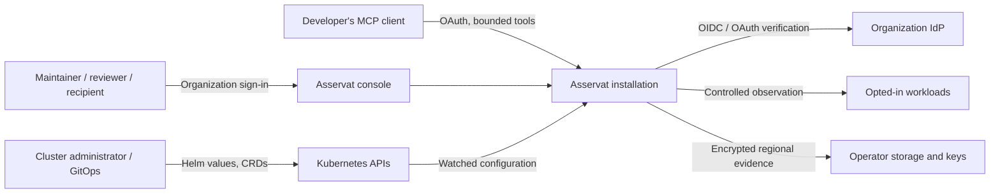
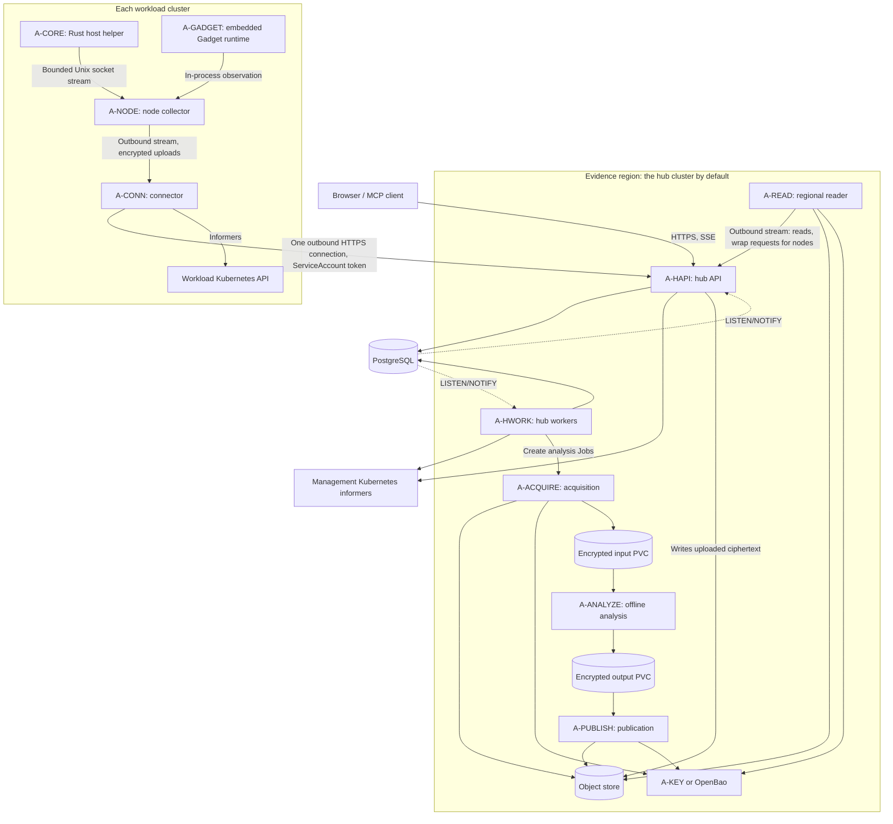

# Applications and deployment

These are scheduling and authority boundaries. Component and package names do not imply additional Deployments. Roles are separate even when they share the Go executable. Mechanisms follow [ADR-330](../decisions/330-event-driven-system-design.md); the threat model is [ADR-328](../decisions/328-administrator-only-namespaces.md).

## Context and application views

Arrows describe initiated connections or data movement, not authority inheritance. No hub process dials a node or a workload cluster; a workload cluster reaches the hub only through its connector's HTTPS connection to the hub URL, through any Ingress or Gateway (ADR-334). The connector has a private ClusterIP endpoint for collectors; no NodePort, host-network listener or workload-facing debug service. Nodes encrypt evidence before it leaves them, with data keys wrapped by a reader on their behalf; the hub writes the ciphertext to the object store and cannot unwrap it. Readers and analysis run beside the object store they read. Gadget uses its qualified local interface. Analysis data moves through PVC handoff, not pipes between concurrently running Jobs.

## Role inventory

| ID / role | Entry point | Deployment, authority and scaling |
| --- | --- | --- |
| A-SETUP — Helm hook Jobs | `asservat secrets`, `asservat setup` | Idempotent Jobs that do only work needing live external state: generated Secrets (pre-install/pre-upgrade hook), SQL roles, bundled Keycloak realm reconciliation, processing initialization, key and object-store setup, credential rotation and the restore recovery step. setup retries unreachable providers with backoff until its `activeDeadlineSeconds`. Helm renders every Kubernetes object, CRDs included. |
| A-MIGRATE — database migration | `asservat setup` (migration step) | Helm hook Job with an exclusive migration lock and a dedicated DDL login. No superuser, artifact keys or workload credentials; runtime Pods never receive this login. |
| A-HAPI — hub API | `asservat hub-api` | Unprivileged Deployment, two replicas by default, RollingUpdate keeping at least two available; no client stickiness. React/TypeScript console assets, browser/MCP, OAuth, connector connections, evidence upload intake and typed command/query services. One SQL login. No workload kubeconfigs, CRI access or evidence unwrap. |
| A-HWORK — hub workers | `asservat hub-worker` | Unprivileged Deployment, two replicas by default: one leader-elected through a Lease, one standby. Outbox and audit export, sharing, lifecycle and retention deadlines, webhook delivery, capacity accounts, analysis Jobs. Work rows are claimed with `FOR UPDATE SKIP LOCKED` and woken by `LISTEN/NOTIFY`; no fixed-interval sweeps. hub-api does not depend on the Lease. One SQL login. |
| A-CONN — connector | `asservat connector` | Per-cluster unprivileged Deployment, two replicas by default with leader election for the connection. Shared informers on namespaces, workloads, Pods, EndpointSlices and AccessBindings, pushed to the hub on change ([cluster observations](cluster-observations.md)); local CRD writes, SubjectAccessReview (an allow is reused for at most 30 s, a denial is not cached), the budget lease. Holds the cluster's one hub connection, authenticated with its projected ServiceAccount token (ADR-334, [connector identity](connector-credentials.md)). |
| A-NODE — collector | `asservat node` | Privileged DaemonSet in the collector namespace, enabled by default where that namespace's privileged Pod Security level is allowed; `collector.nodeSelector` narrows the nodes. CRI/namespace/cgroup/BPF access limited to qualified adapters. Owns local sensors, triggers, rings, execution and encryption; uploads ciphertext over the connector. Authenticates to the connector with an audience-bound projected token (TokenReview once per connection). No hub SQL or general Kubernetes write credential. |
| A-CORE — crash helper | `asservat-core-helper` (static Rust) | Host executable invoked by the kernel. Local socket handoff only; no SDK, DNS, Kubernetes, KMS or network call. Installed only by the explicitly enabled node mechanism. |
| A-GADGET — observation engine | Inspektor Gadget linked into the collector (build tag `gadget`) | Runs inside A-NODE. Exposes only allowlisted packet/syscall mechanisms with bounded node-local output. Cannot authorize collection. |
| A-READ — regional reader | `asservat download-worker` | Long-running unprivileged Deployment beside its region's object store (a hub Deployment for the default hub store), scaled by replicas; no Job per download. Serves native downloads (range reads) and bounded stored-evidence queries over its stream and verifies the envelope, manifest and index of new artifacts before publication; holds the region's evidence read and unwrap credential. Reads do not depend on live source-workload capacity. |
| A-ACQUIRE — analysis acquisition | `asservat acquire` | Short-lived unprivileged Job for offline analysis only. Exact approved inputs and private symbols, object read and unwrap; stages to encrypted input PVCs. Runs no target code or parser. |
| A-ANALYZE — analysis | `asservat analyze` | Short-lived no-network Job without service-account token or cloud credential. Read-only inputs, bounded output, constrained tools; parser crashes stay here. |
| A-PUBLISH — publication | `asservat publish` | Job started after the analyzer has terminated. Validates the output tree, encrypts and uploads under write-only object and wrap-only key scopes. |
| A-KEY — local key service | `asservat key-service` | Unprivileged Deployment, the default key service (OpenBao optional). Holds purpose-scoped wrapping keys; unwrap only for the `download-reader` mTLS role. Private mTLS [I-14](local-key-service.md); never receives artifact payloads. |

Image sharing never means service-account or credential sharing. Each deployed process has one SQL login with the grants it needs ([persistence](../../specs/persistence.md)). Runtime packs add qualified tools only to analyzer images.

## Infrastructure and packaging

Reuse operator-provided services or select the internal/bundled identity, key, PostgreSQL and S3 alternatives of [ADR-063](../decisions/063-small-deployment-alternatives.md) ([small-deployment research](../research/small-deployments.md)). Installation is Helm-native ([Helm guide](../installation/helm.md)) and works with a hostname and an identity provider alone ([ADR-335](../decisions/335-usable-by-default.md)): the chart renders CRDs, RBAC, Secrets, ConfigMaps and workloads; hook Jobs create SQL roles and key/object-store state idempotently, and every value can change on `helm upgrade`. Components read mounted configuration or watch it and trust RBAC and TokenReview. `mode: combined` (the default) runs hub and workload roles in one release; a workload-cluster release (`mode: cluster`) runs the connector and node collector and is registered in the hub's values by name and ServiceAccount issuer. The core mechanism is opt-in and never changes this developer workstation.

Control Pods use read-only filesystems, non-root identities and Restricted security settings. Node privileges and host mounts are documented exceptions in the collector namespace; observed namespaces retain Pod Security restricted. Object access uses configured pools and role credentials, never request-supplied URLs. Analyzer manifests come from reviewed templates.

## Lifecycle, availability and readiness

- Startup loads only that role's dependency set. An optional mechanism failure affects that capability, not evidence reads.
- Readiness probes report the role's own dependencies: hub API (SQL, identity provider settings), hub worker (per work class), connector (hub connection, informer sync, node coverage), node (detector and recorder readiness, adapter qualification). A ready Pod does not prove complete history.
- Configuration comes from informers or mounted files and stays valid until replaced; a watch failure marks only the affected source unavailable until relist.
- Shutdown stops new work and drains in-flight work within its existing deadline. A node source cannot migrate to another node; a replacement reports a gap.
- Each effect carries its idempotency key and attempt identity; a leader Lease does not by itself fence an effect.
- Database restore uses the chart's `recovery` value ([restore](../installation/helm.md#restore)): `helm upgrade` with it scales hub workloads and the local connector to zero, restores and runs setup's recovery step, which advances the installation epoch; a following upgrade without it starts them again. Components read the epoch at startup and on reconnect.
- N/N−1 hub–connector protocol compatibility is the rule, so hub and workload clusters upgrade independently. Hub upgrades roll without downtime. Rolling node upgrades drain or expire source sessions; rings are not migrated. Schema migrations expand/contract so the previous minor release runs on the current schema.

## Isolation and capacity

Separate queue budgets for denial/Stop delivery, protected saves/uploads, normal collection/analysis and live delivery, with weighted workload fairness within each class. Live viewers shed first; Stop and denial must get through under load. Each hub process has a fixed share of installation DB connections. Connector caches and node buffers have hard limits. Read replicas never approve rights, spend or revocation-sensitive delivery.

Replica counts, requests/limits and throughput ceilings come from the measurements in [implementation slices](implementation-slices.md).
