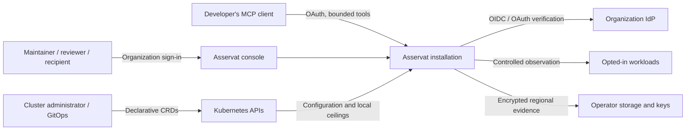
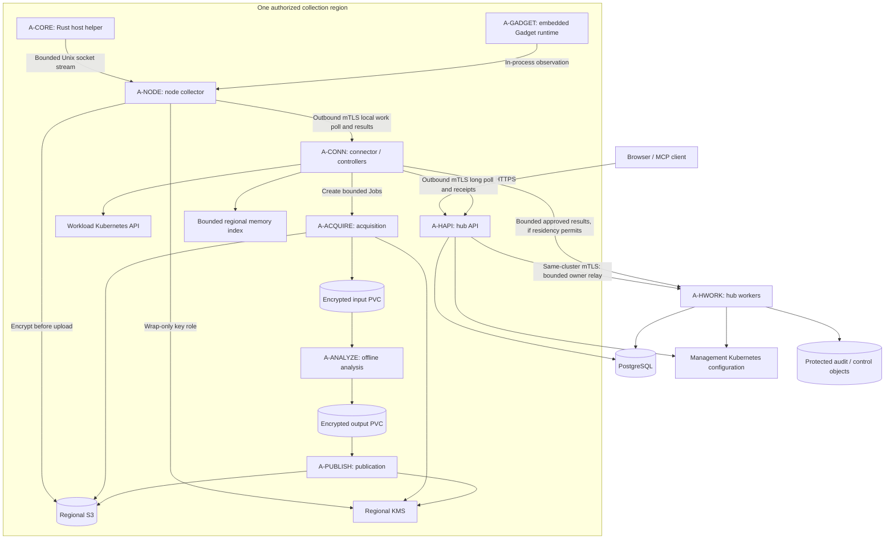

# Applications and deployment

These are scheduling and authority boundaries. Component names and package names do not imply additional Deployments. Production roles are separate even when they use the same Go executable.

## Context and application views

Arrows describe initiated requests or data movement, not authority inheritance. No hub process dials a node. The local connector has a private ClusterIP endpoint for collectors; no NodePort, host-network listener or workload-facing debug service. Gadget uses its qualified local interface, never a general remotely callable BPF service. Analysis data moves through fenced PVC handoff, not pipes between concurrently privileged Jobs.

## Role inventory

| ID / role | Entry point / image family | Deployment, authority and scaling |
| --- | --- | --- |
| A-INSTALL — initial activation | `asservat initial-install`; control image | Finite Restricted Pod, initially scheduling-gated, with exact Pod/account/guard pins and separate temporary SQL/audit credentials. No automatic restart, schema DDL, public endpoint, raw-evidence unwrap or restore authority. [Execution contract](initial-installer.md). |
| A-HAPI — hub API | `asservat hub-api`; control image | Unprivileged Deployment. Compiled React/TypeScript assets and app shell, browser/MCP, OAuth, enrollment/federation ingress and typed command/query services. DB runtime credentials and read-only management configuration access. At least two replicas in the HA profile; no per-view client stickiness. Does not hold workload kubeconfigs, CRI access or raw-artifact unwrap rights. |
| A-HWORK — hub workers | `asservat hub-worker`; control image | Unprivileged Deployment with separately scoped identity. Audit/outbox, sharing materialization, hub lifecycle and reconciliation, webhook delivery and leased live-owner routing. Parallel SQL work leases; only singleton config reconciliation uses a leader lease. Fair workload scheduling precedes claims. Scale with queue age within global DB/resource allocations. |
| A-CONN — cluster connector/controller | `asservat controller`; control image | Per-cluster unprivileged Deployment. Local CRD writes, informer/SAR reads, node credential admission, local capacity/permit CAS, Job scheduling and expiry enforcement. Outbound hub sessions; private authenticated node endpoint. HA replicas serve node ingress concurrently; per-resource CAS/fences and leader election bound reconciliation. A short-lived request may reach any replica. |
| A-NODE — collector | `asservat node`; collector image | Privileged DaemonSet only in the collector namespace. One active collector generation per node boot, with CRI/namespace/cgroup/BPF access limited to qualified adapters. Owns local sensors, trigger state, rings, execution, encryption and upload. No hub SQL credentials or general Kubernetes writer credential. Node-initiated connector requests carry current node/boot/process epoch identity. Restart cannot revive old starts or rings. |
| A-CORE — crash helper | `asservat-core-helper`; static Rust artifact | Host-installed executable invoked by the kernel. Authenticated local socket handoff only. No SDK, DNS, Kubernetes, KMS or network call. Installation, core_pattern ownership and uninstall belong to the explicitly enabled node mechanism. |
| A-GADGET — observation engine | Pinned Inspektor Gadget runtime linked into the collector image (build tag `gadget`, ADR-246/S1) and approved preloaded gadget digests | Runs inside the A-NODE process, not as a separate privileged Pod or image (S-04 plan S1: a second privileged process on the same node adds no isolation). Adapter exposes only allowlisted packet/syscall mechanisms and bounded node-local output. Cannot independently authorize collection. |
| A-ACQUIRE — acquisition | `asservat acquire`; staging image | Short-lived unprivileged Job. Exact approved inputs/private symbols, limited object reads and KMS unwrap; stage only on qualified encrypted input/output PVCs. Restricted egress destinations and deadline. Does not run target code or untrusted parsing tools. |
| A-ANALYZE — analysis | `asservat analyze`; mechanism-specific analyzer image | Short-lived unprivileged no-network Job, no service-account token or cloud credential. Read-only verified inputs, bounded writable output, constrained tools. Parser crash is contained here. No raw export or arbitrary debugger scripts. |
| A-PUBLISH — publication | `asservat publish`; staging image | New short-lived Job after the analyzer is terminated and unmounted. Validate a hostile output tree and trusted provenance; encrypt/upload under write-only object and wrap-only key scopes. No acquisition unwrap credential. Parent deadlines bound all results. |
| A-MIGRATE — database migration | `asservat migrate`; control image | Bounded release-maintenance Job with an exclusive migration lock and dedicated database-scoped DDL identity. No superuser, artifact keys, workload credentials or runtime service endpoint. Expand/backfill/validate/contract follows the supported version window; runtime pods never inherit this credential. |
| A-KEY — optional local key service | Planned `asservat key-service`; control image | Unprivileged Deployment in the configured key region. Holds only protected purpose-scoped wrapping/signing keys and current-authority reader credentials. Private mTLS I-14; collector/publisher wrap-only and acquisition unwrap remain separate. No artifact payloads or public user endpoint. Handler/clients/crypto exist; production authorizers, issuer/Secret lifecycle and runnable bootstrap remain pending. |

Image sharing never means service-account or credential sharing. Runtime packs add qualified tools only to relevant analyzer images; the control image does not become a debugger toolbox. The controller hosts regional index/query-cache management initially, as a bounded component with separate queue/memory allocation. Scaling it into a regional worker Deployment is an explicit future operational decision, not a first-release mandatory service. Hub placement is allowed only when that hub is inside the same permitted region and policy allows the cache.

## Infrastructure and packaging

Reuse qualified operator-provided services or explicitly select planned internal/bundled identity, key, PostgreSQL and S3 alternatives under [ADR-063](../decisions/063-small-deployment-alternatives.md). The [small-deployment research](../research/small-deployments.md) selects local identity, an isolated purpose-scoped key-service role, PostgreSQL/pgBackRest and SeaweedFS. [I-14](local-key-service.md) now fixes the private key-service boundary; runtime/provider lifecycle qualification remains pending. Existing diagrams show service capabilities, not mandatory external products. Charts validate readiness and do not silently install platforms. Management-cluster install enables hub roles and selected hub dependencies; workload-cluster install enables connector/node roles and optional qualified Gadget/core/analysis profiles. It does not deploy another identity service or database. One chart family may expose both profiles; same-cluster operation retains role and credential boundaries. The core mechanism is opt-in and never changes this developer workstation.

Control pods use read-only filesystems, non-root identities and restricted security settings. Node privileges and host mounts are explicitly documented exceptions in the collector namespace; observed namespaces retain Pod Security restricted. Object access uses named configured pools and role credentials, never arbitrary URLs from a request. Migration/backup identities remain separate from running hub identities. Analyzer manifests are generated from reviewed templates, not supplied by a user.

## Lifecycle, availability and readiness

- Startup loads only that role's dependency set. Optional mechanism failures affect that capability, not all evidence reads. Database recovery starts RecoveryBlocked; health cannot bypass that gate.
- Hub API readiness requires its authoritative control/query dependencies and safe recovery state. Hub worker readiness describes its work classes separately; an unavailable webhook receiver does not take down collection admission.
- Connector readiness distinguishes hub connection, current configuration, local admission, analysis and node coverage. Local cleanup and prepaid execution do not wait for hub readiness.
- Node reports detector readiness, each recorder's warming/coverage, prewrapped natural-core capacity and adapter qualification independently. A ready pod does not prove complete history.
- Shutdown stops new leases/starts, drains bounded work until its existing deadline, and records uncertainty. It does not extend permits or reset deadlines. A node source cannot migrate to another node; replacement reports a gap/new identity.
- Old workers cannot publish after a newer fence is accepted. A Kubernetes leader lease does not itself fence a process, SQL write, artifact commit or BPF source. Each effect boundary checks the applicable epoch/revision/attempt identity.
- N/N-1 hub–connector protocol compatibility is the existing rule. Rolling node upgrades drain or expire source sessions; no promise of lossless ring migration. Schema migrations expand/contract across the supported window; undoing a binary rollout is not a database rollback strategy.

## Isolation and capacity

Separate queue budgets for denial/expiry control, protected saves/uploads, normal collection/analysis, and live delivery. Apply weighted workload fairness within each class. Live viewers shed first; control channels must remain able to deliver cancellation and denial under traffic pressure. Reserve each hub process's share of installation DB connections; scaling replicas cannot multiply the global pool silently. Controller cache/index memory and node buffers have hard limits. Read replicas are never used to approve rights, spend, or revocation-sensitive delivery.

Production replica counts, requests/limits and throughput ceilings beyond existing defaults require the qualification measurements in [implementation slices](implementation-slices.md). The architecture selects where scaling occurs, not invented performance numbers.

The acquisition role additionally has an independently templated download-only Job mode under [REQ-DLD-003](../../specs/artifact-downloads.md): exact artifact read/unwrap, bounded verified streaming and no plaintext scratch, analyzer or target execution. It is not the acquire/analyze/publish pipeline and does not require analysis storage. Connector and hub relay authenticated bounded bytes transiently only where residency permits; control-plane roles receive no unwrap credentials. No new always-on service is required.

The initial `asservat download-worker` command implements only the A-ACQUIRE credential phase under [ADR-073](worker-startup.md). It consumes the exact protected Job startup inputs and renews its process key credential within original deadlines. It does not yet run the native transfer or the separate analysis-acquisition pipeline. The chart does not deploy this partial runtime.
