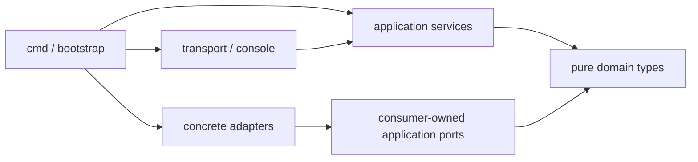

# Code organization and dependency rules

This is the canonical implementation layout. No empty implementation directories are required. Keep one Go module for the Go product initially, with a separate Rust crate for the host helper and a locked React/TypeScript workspace for the console. A “module” below means a cohesive package family, not a separately versioned service or `go.mod`.

```text
cmd/asservat/                    role selection; minimal entry point
internal/bootstrap/             composition roots for each allowed runtime role
internal/domain/                C-24: pure typed values and transitions by domain area
internal/application/
  configuration/ identity/ authorization/ fleet/ targets/
  planning/ capacity/ audit/ capture/ monitoring/ execution/
  recording/ live/ evidence/ privacy/ catalog/ sharing/ analysis/ delivery/
internal/transport/             browser, mcp, admission, federation (connector connection), node, native
internal/console/               embedded assets, app shell and presentation adapters
web/                            React/TypeScript console; C-20; local styles and generated API types
internal/adapters/
  postgres/ kubernetes/ objectstore/ kms/ oidc/ bleve/
  cri/ linux/ gadget/ diagnostics/ tools/
internal/contracts/             reviewed internal transport DTOs; no business authority
api/v1alpha1/                   Kubernetes structs, generated structural schemas/deepcopies
crash-helper/                   isolated Rust crate and local IPC contract fixtures
runtime-packs/                  pinned tools, projection definitions and manifests
charts/asservat/                hub/cluster install profiles, generated CRDs, values schema
migrations/                    ordered SQL migrations and query contracts
test/                          integration, e2e, fuzz, fixtures and benchmarks
scripts/                       existing design gates and future portable local gates
```

Unit tests live next to packages under normal Go conventions. Command names are the role entry points in [applications](applications.md).

## Dependency direction



Only bootstrap chooses concrete adapters, credentials and role capabilities. Domain packages import standard-library value utilities and other explicitly allowed domain values only. `net/netip` is allowed for pure canonical IP parsing/classification; `net` sockets/DNS and HTTP remain infrastructure. They do not depend on logging globals, SQL, Kubernetes, HTTP, MCP, clocks, randomness or filesystem I/O. C-24 analysis values may use standard-library base64 validation and in-memory JSON encoding to bound closed log-page values; this grants no protocol, key or I/O capability. Pass time/identity inputs to pure rules; inject clock/ID generation at the application boundary.

Application packages contain use-case services, state transition orchestration and the interfaces they consume. They may import other application packages only along the catalog's allowed dependency graph; use the smallest public service/facet. Adapters implement those interfaces and may import the consumer's port types. Application code never imports concrete adapters or transport packages. In-memory fakes belong to tests and must obey the same purpose/bound invariants; they are not alternate production storage modes.

Transport packages decode/encode typed DTOs, authenticate at ingress, enforce byte limits and map errors to the existing browser/MCP/peer contract. They call application services. They do not query SQL directly or embed policy logic in a template/tool handler. React renders escaped data from current-authority presentation projections; a DTO copied from a page is never an accepted execution scope.

Shared `internal/contracts` DTOs may be imported by transport/adapters and conversion packages. Domain services receive explicit domain values, not CRD/JSON structures. `api/v1alpha1` represents Kubernetes configuration/local resources only; SQL grant/share/live-watch records do not become CRDs. A value may be represented in several layers with explicit conversion tests.

C-20 owns shared `api/v1alpha1` and `internal/contracts` wire shapes as well as transports. The adapter-to-C-20 edge permits these DTO packages only; the Go gate rejects imports of transport handlers from adapters and imports of internal behavior from shared DTOs. Domain/application packages retain their existing restrictions. This assigns the formerly planned top-level DTO paths without treating Kubernetes representations as pure domain values.

## Transaction and lifecycle boundaries

Keep named transaction ports beside their coordinating application service. For example, `capture.AdmissionTransaction` exposes grant/capacity/share-instruction/operation facets over one SQL transaction. Its PostgreSQL implementation is under `adapters/postgres`; facet mutation rules call owner-domain logic. The callback must be deterministic with respect to provided facts and must not invoke an adapter with remote effects. No generic transaction handle leaks back into services.

Keep local `execution.StartJournal` and `capacity.LocalAdmission` separate from hub transaction interfaces. They key every start by its operation ID; they cannot satisfy a hub SQL transaction through the same interface. Collection and snapshot/live/cleanup purposes have disjoint argument types and entry methods. Do not create a generic event bus that loses those distinctions.

Application context carries validated actor/client, region, trace/operation identity and cancellation. It does not carry arbitrary client-supplied authority. Constructors are not cryptographic capabilities; trust comes from the authenticated ingress and the operation's authorization. Avoid exported mutable global registries and service locators. Mechanism registration is a static allowlist assembled by bootstrap, with pinned runtime packs.

## Package size and abstraction

Each component has a package family, not a package per entity. Split a family when it has a coherent independently testable responsibility; do not create one-interface packages or one repository per domain entry. `planning` may have composition/assessment/guidance subpackages; `monitoring` may have detector/expression/correlation subpackages. Public ports and domain types should remain small enough that unrelated callers do not import runtime-heavy tools.

Use tagged finite action/query unions rather than a generic payload map. Mechanisms need bounded writers and cancellation/coverage outcomes, not a universal executor capable of running arbitrary code. Keep collector-specific kernel details inside adapters; user-facing targeting remains pods even when execution pins internal runtime/process identities.

## Architecture checks

`make architecture-check` validates catalog IDs/paths, acyclic allowed component dependencies, layer restrictions, complete domain/requirement ownership, application/interface endpoints, strict internal-work examples and negative/semantic cases. It does not inspect Go imports or validate distributed execution.

`make go-architecture-check` derives an import graph with Go tooling and maps each product package to a catalog component. It rejects unmapped packages, forbidden layer imports and undeclared cross-component imports; Go compilation and the design catalog gate reject dependency cycles. Bootstrap is an explicit exception only for wiring. Cross-language helper fixtures validate only its narrow IPC; it must not acquire the Go service graph through a subprocess.

Task handoffs name affected component IDs, requirements, changed ports, schema/version effects and actual tests. Use the same portable Make gates locally and in CI.

`internal/bootstrap` is the composition root for every role selected by `cmd/asservat`. The composition exception permits wiring adapters and transports; it does not permit application/domain packages to import them. Kubernetes objects for every role are rendered by the Helm chart, not built in Go.

C-21 reuses C-23 `internal/adapters/logs` for the canonical native-format check
before encryption. This data-only codec adds no collector, API,
credential or execution capability. The Go gate confines the C-21 → C-23 edge to
that package; persistence cannot import Gadget, Linux or other mechanism adapters.
