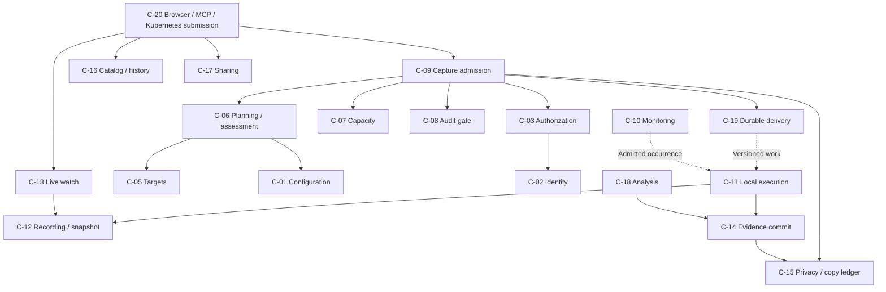

# Components, modules and state ownership

The [catalog](catalog.yaml) is the canonical component/requirement/entity mapping. IDs below identify cohesive code and lifecycle ownership, not additional services. A component may have hub and local facets; those facets cannot exchange a hub repository for a local one merely because their Go interfaces look similar.

## Component map

Solid arrows show major service collaborations, not a complete import list. Dashed arrows cross a process boundary. The catalog specifies allowed imports; wire traffic does not require one runtime to import the implementation of the other. C-04 fleet supplies peer/capability/epoch authority; C-21 and C-23 implement persistence/mechanism ports; C-22 is the isolated Rust helper; C-24 contains pure domain types.

## Responsibilities and ports

| Component | Responsibilities and owned state | Primary interfaces / failure boundary |
| --- | --- | --- |
| C-01 Configuration | Accept Kubernetes definitions, immutable profile versions, protected permission/retention/ceiling inputs; track source UID, revision and freshness. It owns projections, not the user's desired state. | ConfigurationReader/Acceptor. Unknown relist boundary blocks new dependent authority. Permission writes return to Kubernetes. |
| C-02 Identity | Verified principal, group freshness, token/client binding and step-up evidence. | IdentityResolver/StepUpVerifier. Failed refresh cannot invent identity or replace the requester with a controller. |
| C-03 Authorization | Rights evaluator, grants/reservations, retained audience and independent review. Same policy evaluator is used locally with bounded signed inputs. | AuthorizationEvaluator, ReviewService, GrantFacet. A decision has purpose, exact scope and freshness; it is not an unlimited reusable boolean. |
| C-04 Fleet | Cluster registration, connector/node epochs, certificate enrollment/rotation, compatibility and capability projections. | EnrollmentService, PeerVerifier, CapabilityReader. Old enrollment/node-boot identity cannot claim new work. |
| C-05 Targets | Workload/pod resolution, process identity and dynamic service/workload peers. Runtime identity is internal provenance. | TargetResolver/PeerResolver. Unknown/deleted/reassigned identities produce omissions/gaps rather than substitution. |
| C-06 Planning | Profiles/recipes, typed composition, goal guidance, process/network suggestions, combined impact/handling and split source/incident graphs. | PlanCompiler, AssessmentService, GuidanceService. Reads approved snapshots/capabilities; never trials acquisition. Scope bytes/digests are deterministic. |
| C-07 Capacity | Protected workload allocations, shared burst, local slices, admission, fair queues and reserved/committed/uncertain charges. | CapacityFacet, LocalAdmission, FairScheduler. No refund on timeout; no cross-workload protected borrowing. |
| C-08 Audit | Durable intent/result records, object acknowledgements and minimized links. | AuditGate/AuditPublisher. Pending object audit blocks sensitive starts/disclosure; denial still takes effect. |
| C-09 Capture | Preview/accept/cancel, stable operations, typed collection versus recording-save dispatch, action attempt projections and partial progress. | CaptureService, AdmissionTransaction, CaptureReader. Unknown COMMIT is looked up by original key. Hub ActionAttempt is the reconciled aggregate; C-11 owns the local start record. |
| C-10 Monitoring | Accepted policy activation, signal adapters, bounded trigger AST, correlation, rearm, suppression and source readiness coordination. | PolicyController, TriggerEvaluator, SignalSink. Sensor loss yields Unknown; noisy matches aggregate without new dump jobs per match. |
| C-11 Execution | Local start/disposition journal, bounded DAG, process-binding recheck, serialized incompatible actions and cooperative cancellation. | ExecutionDispatcher, StartJournal, ActionExecutor. Receives signed work plus local readiness; a delivery lease is insufficient authority. |
| C-12 Recording | Source epochs/leases, dynamic filter generations, ring coverage, finite manual sources, snapshots and stopped-source grace. | SourceManager, SnapshotExecutor, SourceInventory. Save returns original-window coverage; cannot start a dump, expand a source or manufacture prehistory. |
| C-13 Live | Durable view control and separate transient regional projection/replay, filter revision, viewer checks and bounded output spend. | LiveWatchService/LiveProjectionOwner. Pause does not pin history; source/view loss is a gap or terminal state; no event rows in SQL. |
| C-14 Evidence | Streaming encryption/upload, immutable manifests, commit verification, artifacts and lineage. | EvidenceWriter, CommitService, ArtifactReader. Registers every copy through C-15; an uploaded segment is not committed evidence. |
| C-15 Privacy | Effective retention, managed-copy registration/state, early restriction/erasure, local cleanup, backup horizons and deletion tombstones. | RetentionResolver, CopyLedger, PrivacyService. Uses authoritative lineage through a read port; never imports the evidence service to perform cleanup. Unknown deletion stays charged. |
| C-16 Catalog/history | Cases, occurrences, authorized list/search, selector-keyed request history and protected parameter snapshots. | CatalogQuery, HistoryService, SearchProjection. Cases/grouping/indexes cannot grant access. Regional text cache is rebuildable; SQL contains minimized catalog fields only. |
| C-17 Sharing | Multiple managers, concrete artifact shares, bounded SharingIntent registration/materialization, stop/revoke and recipient views. | SharingService, SharingFacet, PublicationTransaction. Parent denial precedes cleanup; failure to publish never silently broadens default audience. |
| C-18 Analysis | Bounded approved/raw queries, exact artifact/tool/runtime inputs, stage orchestration, safe output and compatible runtime-profile comparison. | AnalysisService, StageCoordinator, AnalyzerRegistry. Artifact retention bounds all jobs; one failed parser cannot compromise a network-enabled acquisition process. |
| C-19 Delivery | SQL/local outbox mechanics, work claims, lease fences, peer routing, receipt ingestion and minimized CloudEvents. | WorkRouter, ReceiptService, OutboxPublisher. At-least-once transport cannot decide that an uncertain process start is safe to retry. Semantic owners classify work. |
| C-20 Transports/console | Browser/MCP/public integration and internal peer handlers, Kubernetes admission adapters, React/TypeScript console, static assets and typed presentation projections. | Typed handlers to application services. No direct repository write or alternate authorization path. Roles are composed separately; not every process enables every handler. |
| C-21 Persistence adapters | Role-scoped PostgreSQL, Kubernetes, S3, KMS, OIDC and regional memory-index implementations. | Consumer-owned ports. SQL and local Kubernetes implementations have distinct authority types and factories; they are not interchangeable production backends. |
| C-22 Core helper | Numeric kernel input validation, local peer authentication and bounded crash-byte handoff. | I-03. No remote dependency; prepared node admission can promptly refuse. |
| C-23 Mechanism adapters | CRI/Linux identity/files/processes, qualified Gadget, endpoint profiling and sandboxed diagnostic tools. | I-10/I-11. Mechanism cannot choose an unapproved target, bypass the output writer or publish directly. |
| C-24 Domain types | Typed identifiers, values, finite tagged unions and pure transition validation. | No I/O. Domain constraints are reusable across roles; current rights and quotas still require application checks. |

## Ownership of important cross-component transactions

| Transaction / transition | Coordinator | Participating owned facets | External work after commit |
| --- | --- | --- | --- |
| Accept capture / admit dispatch | C-09 | Configuration/fleet fences, C-03 grant, C-07 capacity, C-17 optional registration, operation/attempt and C-19 outbox | C-08 durable audit; C-19 delivery; C-11 local admission |
| Register pending copy | C-14 | C-15 copy registration, C-07 reservation, immutable write intent | Bounded encryption/upload, manifest commit and independent object verification |
| Finalize verified artifact | C-14 | Verified artifact/lineage, C-15 copy state, C-07 conversion of reservation, C-16 catalog/occurrence association and audit/outbox reference | C-17 materialization and status projection; disclosure still requires acknowledged durable audit |
| Publish share selection | C-17 | Current authority/approval, intent/slot/share revision, artifact visibility, audit/outbox | Durable audit acknowledgement before new reads |
| Restrict/expire/delete | C-15 | Denial epoch, copy/lineage lifecycle work, C-07 conservative charges, audit/outbox | Local object/PVC/index/backup cleanup; verify absence before releasing copy charge |
| Open/change live view | C-13 | Current viewer/source checks, view revision/fence, C-07 finite view slices, audit/work references | Regional projection owner; transient batches under repeated checks |

The canonical SQL lock order remains in [persistence](../../specs/persistence.md). These are facets of one transaction, not nested service calls that independently commit. A facet exposes only its invariant-preserving operations; there is no `GetDB()` or unrestricted `ExecSQL()` port. Runtime effects, IdP/SAR calls, object operations and user callbacks never execute while the transaction holds locks. External freshness proofs are gathered first and their versions/fences checked inside the transaction. An adapter may implement several facets over one transaction; ownership still determines which transitions are legal.

Local Kubernetes admission is different: CAS updates a bounded local account/permit, with grant and capacity bundles prepaid by the hub. No claim of multi-object Kubernetes atomicity is made. The bundle references one durable spend record per admitted effect; interruption at an intermediate reservation remains conservatively charged. See [runtime flow R-03](runtime.md#r-03-local-start-and-ambiguous-retry).

## Feature extension examples

A new pprof-compatible endpoint affects the diagnostics mechanism adapter and its qualification, the typed action contract, planning/assessment rules, analysis adapter where the format changes, and profile catalog. It does not add a new browser-specific runner. A new trigger adds a typed signal/predicate adapter to monitoring, bounded semantics and fixtures; it cannot call execution directly without incident admission. A new live projection needs its own approved field schema, pre-read privacy/processing budgets, adapter qualification and shared browser/MCP mapping. Existing raw-query access is not permission for raw live delivery.

C-14 also owns ArtifactDownload admission/state and the native stream; C-03 supplies exact download authority, C-07 reserves transfer/read-work budgets, C-08 gates disclosure on durable audit, C-15 supplies cutoff and cleanup facts, and C-19 carries only minimized dispatch/status. C-20 exposes the common browser/MCP handoff. All evidence kinds use this service; adapters do not invent separate export permissions.

## Combined investigation review

C-03 owns parent resultAccess decisions, exact post-commit child grants, output registration and shared disclosure accounting. C-06 resolves selected output aliases and access limits; C-09 retains the accepted instruction without granting rights. C-14 supplies trusted verified commit identity and requests authorization publication through the existing durable transaction/outbox; a failed publication leaves evidence saved with access pending. C-20 renders one review and two progress dimensions. This adds no application, network protocol or permission-configuration API. [REQ-INV-001–003](../../specs/investigation-approval.md) define the boundary.
