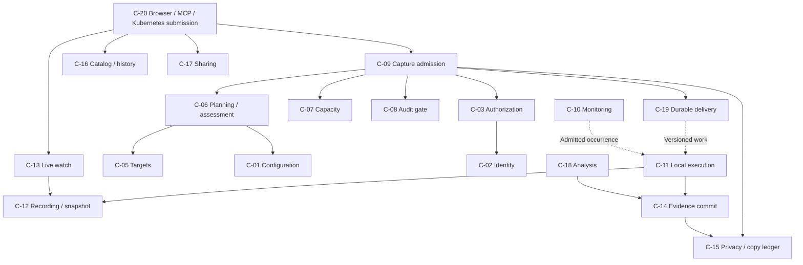

# Components, modules and state ownership

The [catalog](catalog.yaml) is the canonical component/requirement/entity mapping. IDs below identify cohesive code and lifecycle ownership, not additional services. A component may have hub and local facets; those facets cannot exchange a hub repository for a local one merely because their Go interfaces look similar.

## Component map

Solid arrows show major service collaborations, not a complete import list. Dashed arrows cross a process boundary. The catalog specifies allowed imports; wire traffic does not require one runtime to import the implementation of the other. C-04 fleet supplies peer/capability/epoch authority; C-21 and C-23 implement persistence/mechanism ports; C-22 is the isolated Rust helper; C-24 contains pure domain types.

## Responsibilities and ports

| Component | Responsibilities and owned state | Primary interfaces / failure boundary |
| --- | --- | --- |
| C-01 Configuration | Kubernetes definitions from informers and mounted files: immutable profile versions, permission, retention and ceiling inputs, `generation`/`observedGeneration` status. It owns projections, not the user's desired state. | ConfigurationReader. A projection stays valid until the watch replaces it; a watch failure marks the source unavailable until relist. Permission writes return to Kubernetes. |
| C-02 Identity | Verified principal, group names from the configured groups claim, token/client binding and, when `approvals.stepUp` is set, step-up evidence. | IdentityResolver; StepUpVerifier is optional and unused by default (ADR-335 D5). Failed refresh cannot invent identity or replace the requester with a controller. |
| C-03 Authorization | Rights evaluator, grants, retained audience and independent review. | AuthorizationEvaluator, ReviewService, GrantFacet. One decision per operation with purpose and exact scope, reused for at most `identity.AuthorityRecheckInterval` and never past the operation's original deadline ([ADR-311](../decisions/311-operation-authority-recheck.md)). |
| C-04 Fleet | Per-cluster registration from the hub's `clusters` values, ServiceAccount-token connector authentication ([connector identity](connector-credentials.md)) and the optional passthrough client certificate, connector connection routing, compatibility and capability reported by connectors and collectors. | ConnectorAuthenticator, PeerVerifier, CapabilityReader. A disabled cluster cannot connect or receive work. |
| C-05 Targets | Workload/pod resolution, process identity and dynamic service/workload peers. Runtime identity is internal provenance. | TargetResolver/PeerResolver. Unknown/deleted/reassigned identities produce omissions/gaps rather than substitution. |
| C-06 Planning | Profiles/recipes, typed composition, goal guidance, process/network suggestions, combined impact/handling and split source/incident graphs. | PlanCompiler, AssessmentService, GuidanceService. Reads approved snapshots/capabilities; never trials acquisition. Scope bytes/digests are deterministic. |
| C-07 Capacity | Per-workload byte/object quotas counted from live rows and objects, rate limits with burst, concurrency caps and fair queues. | CapacityFacet, LocalAdmission, FairScheduler. Conditional updates lock only the affected workload row (plus one pool row when burst applies). An unknown outcome is resolved by its idempotency key and the charge released when known; no cross-workload borrowing. |
| C-08 Audit | Append-only audit rows written in the effect's SQL transaction, batched export to object storage or a SIEM, retention by time partition. | AuditWriter/AuditExporter. The operation fails if its row cannot be written; export lag never blocks effects or denial. |
| C-09 Capture | Preview/accept/cancel, stable operations, typed collection versus recording-save dispatch, action attempt projections and partial progress. | CaptureService, AdmissionTransaction, CaptureReader. Unknown COMMIT is looked up by original key. Hub ActionAttempt is the reconciled aggregate; C-11 owns the local start record. |
| C-10 Monitoring | Accepted policy activation, signal adapters, bounded trigger AST, correlation, rearm, suppression and source readiness coordination. | PolicyController, TriggerEvaluator, SignalSink. Sensor loss yields Unknown; noisy matches aggregate without new dump jobs per match. |
| C-11 Execution | Start disposition by operation ID (hub `capture_start` row, connector in-memory attempt state; [local start](local-start.md)), bounded DAG, process-binding recheck, serialized incompatible actions and cooperative cancellation. | ExecutionDispatcher, StartJournal, ActionExecutor. Receives work with its operation ID over the authenticated connector connection; a redelivered ID returns the recorded start disposition. |
| C-12 Recording | Ongoing source sessions that run to their admitted hard end, dynamic filter generations, ring coverage, finite manual sources, snapshots and stopped-source grace. | SourceManager, SnapshotExecutor, SourceInventory. Save returns original-window coverage; cannot start a dump, expand a source or manufacture prehistory. |
| C-13 Live | Durable view control and separate transient regional projection/replay, filter revision, viewer checks and bounded output spend. | LiveWatchService/LiveProjectionOwner. Pause does not pin history; source/view loss is a gap or terminal state; no event rows in SQL. |
| C-14 Evidence | Streaming encryption/upload, immutable manifests, commit verification, artifacts and lineage. | EvidenceWriter, CommitService, ArtifactReader. Registers every copy through C-15; an uploaded segment is not committed evidence. |
| C-15 Privacy | Stored effective retention deadlines per artifact, managed-copy registration/state, early restriction/erasure, local cleanup and backup horizons. | RetentionResolver, CopyLedger, PrivacyService. A policy change shortens deadlines with one set update; deletion runs from the deadlines. Uses lineage through a read port; never imports the evidence service. A copy's charge is released once deletion is verified. |
| C-16 Catalog/history | Cases, occurrences, authorized list/search, selector-keyed request history and protected parameter snapshots. | CatalogQuery, HistoryService, SearchProjection. Cases/grouping/indexes cannot grant access. Regional text cache is rebuildable; SQL contains minimized catalog fields only. |
| C-17 Sharing | Share manager groups, concrete artifact shares, capture-time share instructions materialized at publication, stop/revoke and recipient views. | SharingService, SharingFacet, PublicationTransaction. Parent denial precedes cleanup; failure to publish never silently broadens default audience. |
| C-18 Analysis | Bounded approved/raw queries, exact artifact/tool/runtime inputs, stage orchestration, safe output and compatible runtime-profile comparison. | AnalysisService, ContextProjectionService, StageCoordinator, AnalyzerRegistry. Stored-evidence queries run on the regional reader ([context projection](context-projection.md)); offline analysis uses Jobs. Artifact retention bounds all work; a failed parser cannot compromise a network-enabled process. |
| C-19 Delivery | SQL outbox, `LISTEN/NOTIFY` wake-ups, routing over the connector connection, receipt ingestion and minimized CloudEvents. | WorkRouter, ReceiptService, OutboxPublisher. Each work item carries its operation ID; a redelivery with the same ID returns the existing outcome instead of repeating the effect. |
| C-20 Transports/console | Browser/MCP/public integration and internal peer handlers, Kubernetes admission adapters, React/TypeScript console, static assets and typed presentation projections. | Typed handlers to application services. No direct repository write or alternate authorization path. Roles are composed separately; not every process enables every handler. |
| C-21 Persistence adapters | Role-scoped PostgreSQL, Kubernetes, S3, KMS, OIDC and regional memory-index implementations. | Consumer-owned ports. SQL and local Kubernetes implementations have distinct authority types and factories; they are not interchangeable production backends. |
| C-22 Core helper | Numeric kernel input validation, local peer authentication and bounded crash-byte handoff. | I-03. No remote dependency; prepared node admission can promptly refuse. |
| C-23 Mechanism adapters | CRI/Linux identity/files/processes, qualified Gadget, endpoint profiling and sandboxed diagnostic tools. | I-10/I-11. Mechanism cannot choose an unapproved target, bypass the output writer or publish directly. |
| C-24 Domain types | Typed identifiers, values, finite tagged unions and pure transition validation. | No I/O. Domain constraints are reusable across roles; current rights and quotas still require application checks. |

## Ownership of important cross-component transactions

| Transaction / transition | Coordinator | Participating owned facets | External work after commit |
| --- | --- | --- | --- |
| Accept capture / admit dispatch | C-09 | C-03 grant, C-07 capacity, C-17 optional share instruction, operation/attempt with idempotency key, C-08 audit row and C-19 outbox | C-19 delivery; C-11 local admission |
| Register pending copy | C-14 | C-15 copy registration, C-07 reservation by operation ID, manifest expectation | Bounded encryption/upload with streamed SHA-256 checksums, commit envelope |
| Publish committed artifact | C-14 | Regional reader's envelope, manifest and index verification against the stored expectation ([manifest verification](manifest-verification.md)); artifact/lineage, C-15 copy state and retention deadline, C-07 charge, C-16 catalog association, C-08 audit row and outbox | Status notification; data frames are authenticated by AEAD on every read |
| Publish share selection | C-17 | Current authority/approval, share revision, artifact visibility, C-08 audit row and outbox | Status notification |
| Restrict/expire/delete | C-15 | Stored deadline or restriction, copy/lineage lifecycle work, C-08 audit row and outbox | Object/PVC/index cleanup; one absence check, then mark deleted, release the charge and write the audit row in one transaction |
| Open/change live view | C-13 | Viewer authorization, view revision, C-07 finite view slices, C-08 audit row and work reference | The connector streams transient batches to the hub replica holding its connection |

The canonical SQL lock order remains in [persistence](../../specs/persistence.md). These are facets of one transaction, not nested service calls that independently commit. A facet exposes only its invariant-preserving operations; there is no `GetDB()` or unrestricted `ExecSQL()` port. Runtime effects, IdP/SAR calls, object operations and user callbacks never execute while the transaction holds locks. Catalog and progress reads are plain MVCC selects; writes lock only the affected rows and detect concurrent permission changes by revision comparison. An adapter may implement several facets over one transaction; ownership still determines which transitions are legal.

Local admission on the connector uses conditional updates of per-workload counters keyed by the operation ID; a retried start with the same ID returns the recorded outcome. See [runtime flow R-03](runtime.md#r-03-local-start-and-ambiguous-retry).

## Feature extension examples

A new pprof-compatible endpoint affects the diagnostics mechanism adapter and its qualification, the typed action contract, planning/assessment rules, analysis adapter where the format changes, and profile catalog. It does not add a new browser-specific runner. A new trigger adds a typed signal/predicate adapter to monitoring, bounded semantics and fixtures; it cannot call execution directly without incident admission. A new live projection needs its own approved field schema, pre-read privacy/processing budgets, adapter qualification and shared browser/MCP mapping. Existing raw-query access is not permission for raw live delivery.

C-14 also owns ArtifactDownload admission/state and the native stream served by the regional reader; C-03 authorizes once at start, C-07 charges transfer budgets, C-08 writes the audit row with the admission, C-15 supplies the stored deadlines that bound the stream ([ADR-312](../decisions/312-started-downloads-run-to-original-bounds.md)), and C-19 carries only minimized dispatch/status. C-20 exposes the common browser/MCP handoff. All evidence kinds use this service; adapters do not invent separate export permissions.

## Combined investigation review

C-03 owns resultAccess decisions on the approved `adHocCapture` grant, output registration and shared disclosure accounting. C-06 resolves selected output aliases and access limits; C-09 retains the accepted instruction without granting rights. C-14 supplies the verified commit identity, and the publication transaction registers the matching outputs; if it fails, the evidence stays stored and unpublished until a retry with the same operation ID. C-20 renders one review and two progress dimensions. This adds no application, network protocol or permission-configuration API. [REQ-INV-001–003](../../specs/investigation-approval.md) define the boundary.
