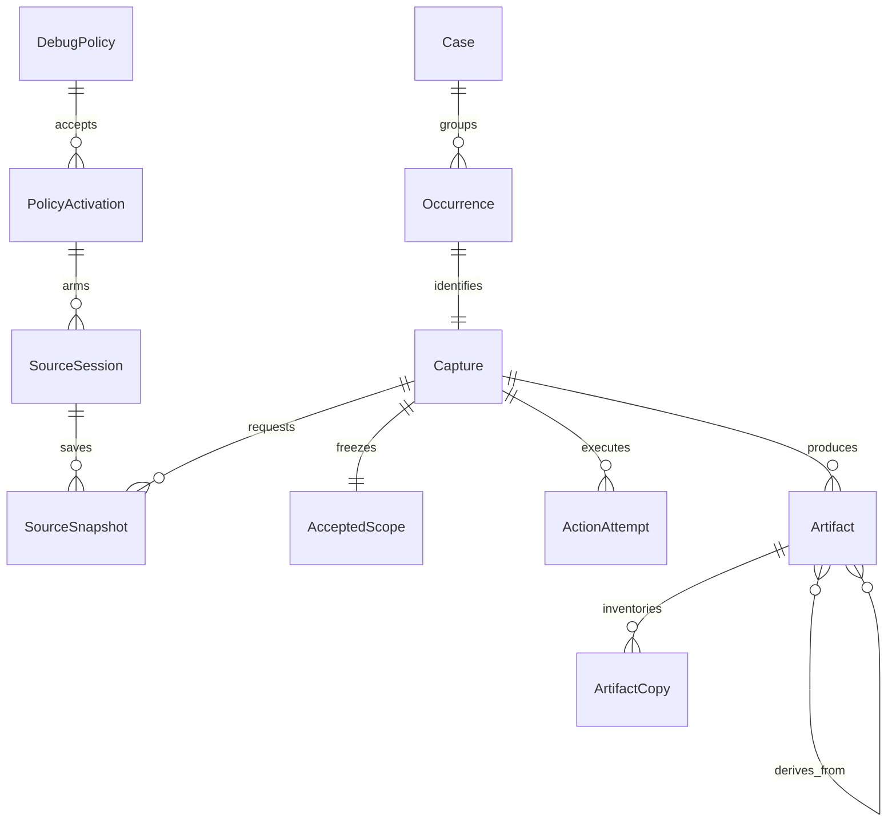
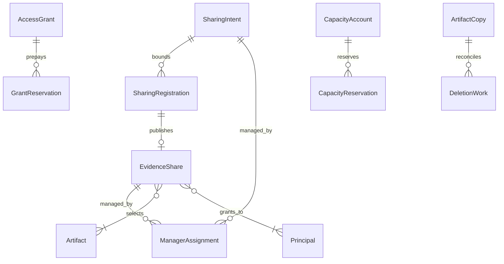
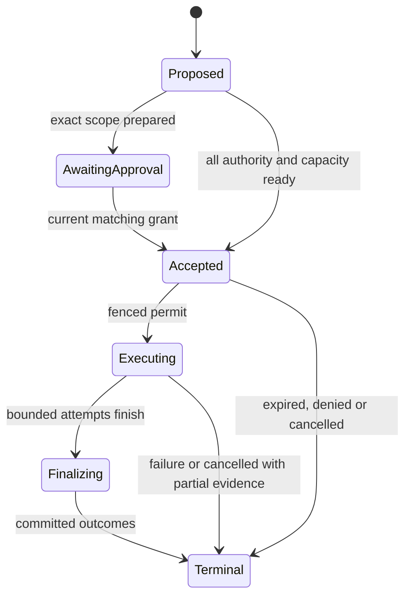

# Domain model

This is the implementation foundation, not a database migration. The [architecture catalog](../architecture/catalog.yaml) assigns each concept one lifecycle owner; [component contracts](../architecture/components.md) define its service boundary. The [typed entity catalog](model.yaml) defines 49 domain entities and projections. [Implementation mapping](implementation-mapping.md) translates them into database, Kubernetes and Go boundaries. Existing [wire schemas](../../specs/contracts/common.schema.json), [execution rules](../../specs/execution.md), [persistence](../../specs/persistence.md) and [authorization](../../specs/authorization.md) remain authoritative for already specified fields and transitions. A conceptual name is not an additional public enum or an instruction to create one table per class.

## Vocabulary that users encounter

| Term | Meaning | Must not imply |
| --- | --- | --- |
| Workload | An enrolled Deployment, StatefulSet or bounded pod selection | Ownership based on a name or a container selector |
| Capture profile | Immutable reusable capture building block | A captured CPU/heap profile or executable plugin |
| Monitoring policy | When to collect, what to observe continuously, what to save, and limits | An unlimited approval |
| Recording | A live, leased source with bounded recent history | Durable evidence or a reserved future snapshot |
| Capture | One accepted, bounded collection or recording-save operation | A policy, an unlimited session or a case |
| Occurrence | The incident/manual event associated with one accepted capture | Proof that every action succeeded |
| Case | A stable grouping of related occurrences | A blanket access-control boundary |
| Artifact | Committed evidence with identity, lineage, audience and deadline | An unauthenticated object-store file |
| Extract | An approved bounded representation of an artifact | Automatically nonsensitive data |
| Share | A concrete artifact selection for explicit recipients | Collection rights or ownership transfer |
| Future sharing instruction | A bounded instruction to publish concrete shares later | An open-ended selector-based share |
| Owner team | A current authorized manager assignment for sharing | The immutable creator or unrestricted evidence reader |

## Identity and value objects

IDs are opaque typed UUIDs for hub records, immutable Kubernetes UIDs for source objects, and `(issuer, subjectType, subjectId)` for users/groups. Names are mutable display values. Do not add tenant IDs, a second identity-provider user directory, or a container ACL. `WorkloadKey = (clusterId, namespaceUid, workloadUid)`; a selector identity also includes canonical selector semantics and namespace UID. A new same-named namespace/workload is a different target and history scope.

`ConfigRef` contains cluster, namespace identity, API kind, resource UID, opaque resourceVersion, generation, content digest and observation time. Never parse or numerically compare resourceVersion. `PodIdentity` adds immutable pod UID; `NodeIdentity` includes node UID and boot ID. `ProcessIdentity` adds runtime identity, PID namespace, PID and start-time discriminator. Re-resolve stable executable/runtime rules, then freeze exact identities for the attempt; a recycled PID never satisfies an old permit.

`Instant` is RFC3339 UTC on the wire and `timestamptz` in SQL. Durations are bounded explicit-unit values, never bare milliseconds of ambiguous meaning. Monotonic timestamps are node/boot-scoped; mapping to UTC includes uncertainty. `Bytes` and counts are bounded nonnegative integers with overflow-checked arithmetic. Revisions/fences are separate types. A fence is not a grant; an ID/URI/cursor is not authority.

`ResourceVector` has separately typed counters: source memory/ring bytes, frozen snapshot bytes, output stored bytes/object count, observed bytes/events, action starts, active slots, CPU/wall limits and transfer slots/rates. Do not add dimensionally different counters. Each adapter specifies which dimensions it consumes. `Coverage` contains requested/observed intervals, clock bounds, source epochs, loss, truncation and confidence; an empty fully observed interval differs from unavailable history.

`DataClass` (`metadata`, `extract`, `raw`) governs projection; `PrivacyClass` records possible personal/user/credential content; neither is inferred solely from file extension. `ProtectedRef` is an opaque encrypted-object reference plus integrity/region/deadline metadata, never a signed download URL. Scope, command arguments, reasons, detailed manifests and evidence-bearing labels belong in protected objects, not general SQL, metrics or audit fields.

## Relationships

A source belongs to one pod/action/node-boot epoch and accepted policy activation. Filter generations can change inside a qualified source without restarting it; each snapshot records the generations actually observed. A new source epoch never fills a prior source’s gap. A snapshot depends on the source but does not own its lifetime: cancelling a save releases its pins, not the independently authorized recorder.

A failed capture can have zero artifacts. A partial capture can expose committed artifacts while another action is blocked. Case projection authorizes artifacts independently; hidden children do not contribute counts, titles, suggestions or timeline placeholders. Analysis can create multiple derived artifacts with multiple parents; lineage is an acyclic graph and every parent constrains authorization, region and expiry.

Recipients are issuer-scoped immutable subject references. A group is resolved through current identity freshness; sharing does not clone a group roster forever. Multiple manager assignments allow multiple owner teams. Manager membership and evidence-read entitlement remain separate checks. `createdBy` and initiating/executing actor identities are immutable provenance even after an owner-team transfer.

## Aggregate boundaries and commands

| Aggregate / service | Commands | Protected invariant / transactional result |
| --- | --- | --- |
| Configuration projection | Accept observed revision, invalidate stale source | Kubernetes remains writer; reject out-of-order incarnation or stale scope |
| Capture admission | Preview, submit, cancel | Allocate identity before review; immutable scope and idempotency; reserve exact grants/capacity before side effect |
| Policy activation | Accept generation, arm, suspend | Bind executor/digest/grants; detector and recorder readiness are distinct; no implicit approval renewal |
| Source execution | Start, renew, update peers, freeze, stop | Fenced source lease; bounded memory; no acquisition before permission/resource readiness |
| Recording save | Select current sources, preview, submit | One policy/workload scope; immutable first-acceptance end time; after=0; no on-trigger DAG |
| Artifact publication | Commit, derive, restrict | Verify encrypted object/manifest; install lineage, audience, privacy deadlines and copy charges together |
| Grant | Request, approve, deny, reserve, spend, revoke | Independent current reviewer and verified step-up; exact scope; ambiguous starts remain spent/uncertain |
| Sharing | Create concrete share, register publication, stop future, revoke, transfer managers | Bound slots; current authority at materialization and delivery; raw selection review; no expiry reset |
| Analysis | Plan bounded query, stage, run, publish, cancel | Input authorization on acceptance and delivery; encrypted phase handoff; derived deadline minimum |
| Capacity | Reserve, allocate slice, commit, reconcile | Canonical lock order; protected workload allocations; uncertain usage stays charged |
| Privacy | Restrict processing, shorten deadline, erase, verify copies | Reads stop at cutoff; capacity released only on verified absence; descendant propagation |

Cross-aggregate admission uses one hub transaction for operation/idempotency, grant reservations, capacity reservations and bounded sharing registration. Use the lock order in the persistence specification. External network calls occur outside SQL transactions through fenced outbox work. A durable audit gate precedes acquisition. Unknown transaction commit is recovered using the same idempotency identity; never create a fresh intrusive action to resolve uncertainty.

Internal events are versioned minimized facts (`CaptureAccepted`, `AttemptStartRecorded`, `SourceCoverageChanged`, `ArtifactCommitted`, `SharePublished`, `GrantRevoked`, `CopyVerifiedAbsent`), not user-editable commands. Delivery is at least once; consumers deduplicate event IDs and enforce aggregate revision/fence. Public CloudEvents are a separately allowlisted projection, not serialization of internal structs.

## State and time

This diagram names conceptual stages. Public capture states use the existing MCP/capture contracts; source readiness, approval state, per-attempt start disposition and artifact availability are **orthogonal**. Do not encode all combinations in a huge single enum. `Indeterminate` is a liability requiring reconciliation, not automatic failure/refund. Cancellation is a request followed by acknowledgements and final outcomes, not a guarantee of instant stop on disconnected nodes.

A grant expires independently of a short permit. A source’s observation lease expires independently of a capture finalization deadline. Artifact `readUntil <= deleteBy <= earliest acquisition/parent/policy maximum`; deletion budget is inside the maximum. Shares, history snapshots, derived results and backups never extend this chain. A resource deletion must not cascade away copy-ledger liabilities, grant spend, revocation tombstones or immutable provenance.

## Required domain-level verification

Before generating production code, exercise concurrent admission, unknown commit/start, repeated source rotation, PID/name reuse, owner-team departure, revoked share during paginated analysis, source loss between preview/acceptance, restore with old fences, retention shortening and storage deletion denial. The existing requirement scenarios govern expected outcomes; this catalog does not claim those runtime tests have run.

## Live views are query sessions, not captures

`LiveWatch` and transient `LiveBatch` extend the model under [REQ-LIV-001–006](../../specs/live-watch.md). A watch binds one viewer/client, exact source epochs, one approved projection, filter revision, hard/idle deadlines and separate view-resource reservations. Many viewers can refer to one SourceSession without owning or renewing its lifetime. Source replacement requires fresh selection. Start/update/close mutate the view aggregate; they never emit a capture-start command.

A LiveBatch contains short-lived approved rows, per-source positions and explicit gaps. It is not an Artifact, Case, SourceSnapshot or shareable historical object. Rows keep source-time/clock/expiry provenance, not a fabricated durable artifact ID. View revision fences filter changes; source/filter generations preserve acquisition provenance separately. The budget is cumulative across edits/replays, and pause releases subscriptions without changing the absolute deadline. Committed evidence arises only through an ordinary authorized capture/save transaction.
